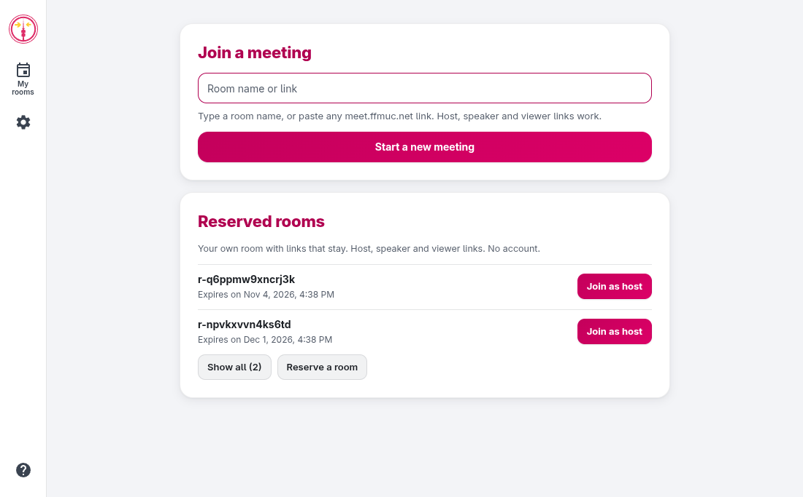
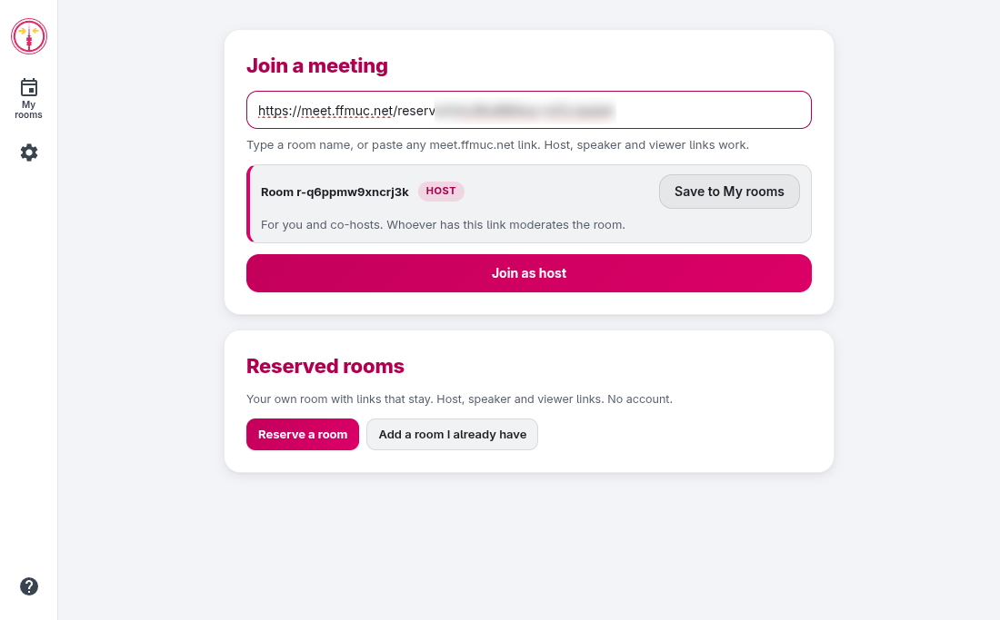
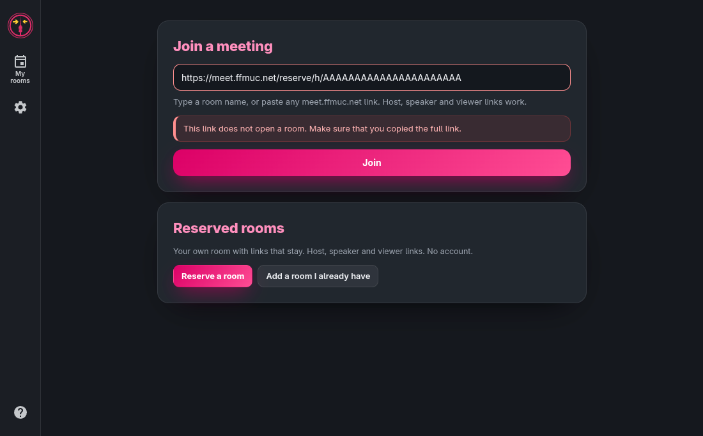
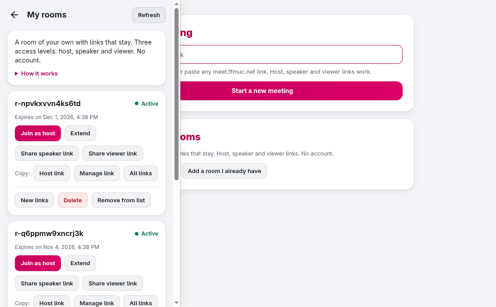
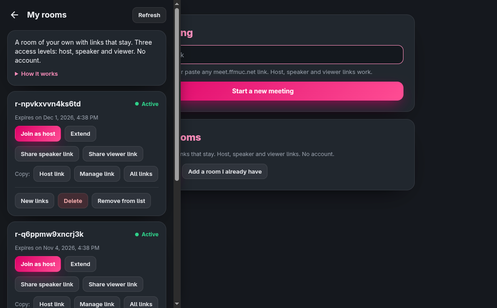
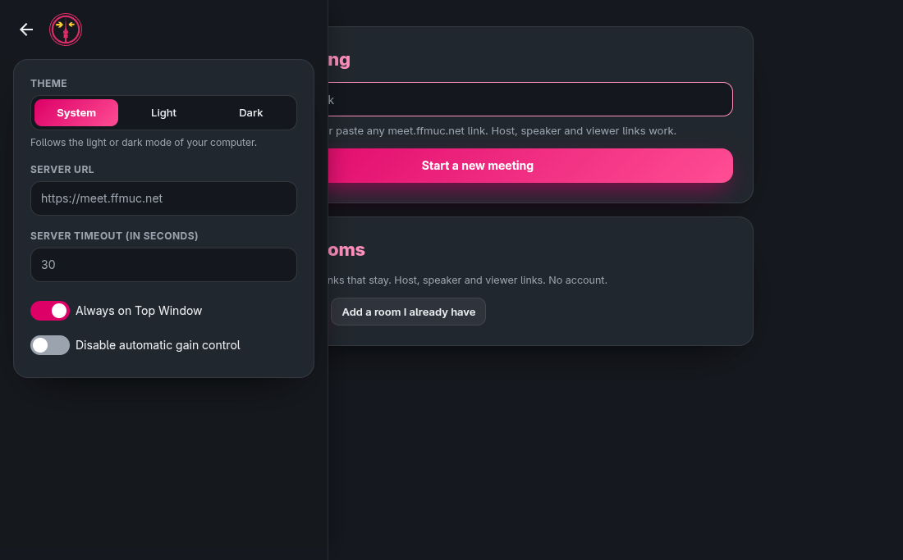

<section data-lang="de" class="language-content active" markdown="1">

**Liebe Freifunkerinnen und Freifunker,**

vor zwei Wochen haben wir [reservierte Räume mit Zuschauer-Modus](/freifunkmuc/meet/2026/10/17/meet-zuschauer-raeume/) auf [meet.ffmuc.net/reserve](https://meet.ffmuc.net/reserve/) gestartet. Jetzt kann das auch unsere **Desktop-App für Windows, macOS und Linux**. Die neue Version **v2026.10.100** bringt reservierte Räume direkt in die App, ein neues Design mit hellem und dunklem Modus und viele kleine Verbesserungen.

**Neue Startseite**

Die App sieht jetzt aus wie die Reservierungsseite. Auf der Startseite findest du drei Bereiche: **Meeting beitreten**, **Reservierte Räume** und **Letzte Meetings**. Räume, die du moderierst, sind dort mit einem **Host**-Abzeichen markiert.

**Jeden Link einfach einfügen**

Ins Startfeld kannst du einen Raumnamen tippen oder jeden Link von meet.ffmuc.net einfügen, auch Moderations-, Sprecher- und Verwaltungslinks. Die App zeigt dir vor dem Beitritt, in welchen Raum und mit welcher Rolle du kommst. Mit **In Meine Räume speichern** merkt sich die App einen Moderations- oder Verwaltungslink für später.

Ist ein Link abgelaufen, gelöscht oder durch neue Links ersetzt, sagt dir die App das in klaren Worten.

**Meine Räume**

Unter **Meine Räume** verwaltest du deine reservierten Räume, ganz ohne Konto:

- einen neuen Raum **reservieren** oder einen vorhandenen Raum über seinen Moderations- oder Verwaltungslink **hinzufügen**,
- **als Moderator:in beitreten**,
- Moderations-, Sprecher- und Zuschauerlinks **kopieren oder teilen**,
- den Raum **verlängern**, **neue Links erstellen** oder ihn **löschen**.

Die App speichert den geheimen Teil deiner Links verschlüsselt im sicheren Schlüsselspeicher deines Betriebssystems. Gibt es keinen sicheren Schlüsselspeicher, speichert die App nichts.

**Erinnerungen vor dem Ablauf**

Damit dein Raum nicht abläuft, erinnert dich die App **3 Tage** und **1 Tag** vorher. Ein Klick auf die Meldung öffnet direkt die Optionen zum Verlängern.

**Hell, dunkel oder wie das System**

In den Einstellungen wählst du das Design: **System** (Standard), **Hell** oder **Dunkel**. Mit „System“ folgt die App dem Modus deines Computers.

**Links direkt in der App öffnen**

Die App registriert die Links `ffmuc-meet://` (und weiterhin `jitsi-meet://`). Auch Reservierungslinks funktionieren so, zum Beispiel `ffmuc-meet://meet.ffmuc.net/reserve/h/…`.

**Download**

Die neue Version findest du auf der [Release-Seite bei GitHub](https://github.com/freifunkMUC/jitsi-meet-electron/releases), sobald sie veröffentlicht ist. Alternativ:

- **Windows** (WinGet): `winget install --id freifunkMUC.FreifunkMeet`
- **macOS** (Homebrew): `brew install --cask freifunkMUC/freifunkmeet/freifunk-meet`
- **Linux**: AppImage und .deb für x86_64 und arm64 auf der Release-Seite

Normale Räume funktionieren natürlich genau wie bisher. Mehr zu den Rollen und zum Zuschauer-Modus findest du in unseren Beiträgen zu [reservierten Räumen](/freifunkmuc/meet/2026/10/17/meet-zuschauer-raeume/) und zu [Untertiteln und Zuschauermodus](/freifunk/meet/dienste/2026/10/17/meet-untertitel-und-zuschauermodus/). Wir freuen uns über euer Feedback, gerne auch als [Issue auf GitHub](https://github.com/freifunkMUC/jitsi-meet-electron/issues)!

</section>

<section data-lang="en" class="language-content" markdown="1">

**Dear Freifunk community,**

Two weeks ago we launched [reserved rooms with viewer mode](/freifunkmuc/meet/2026/10/17/meet-zuschauer-raeume/) at [meet.ffmuc.net/reserve](https://meet.ffmuc.net/reserve/). Now our **desktop app for Windows, macOS and Linux** can do this too. The new version **v2026.10.100** brings reserved rooms right into the app, a new look with light and dark mode, and many small improvements.

**New start page**

The app now looks like the reserve page. The start page has three cards: **Join a meeting**, **Reserved rooms** and **Recent meetings**. Rooms you host are marked with a **Host** badge.

**Just paste any link**

In the start field, type a room name or paste any meet.ffmuc.net link, including host, speaker and manage links. Before you join, the app shows the room and your role. **Save to My rooms** keeps a host or manage link for later.

If a link has expired, was deleted or was replaced by new links, the app tells you in plain words.

**My rooms**

In **My rooms** you manage your reserved rooms, no account needed:

- **reserve** a new room, or **add** an existing room from its host or manage link,
- **join as host**,
- **copy or share** host, speaker and viewer links,
- **extend** the room, **make new links** or **delete** it.

The app stores the secret part of your links encrypted in the secure key store of your operating system. If there is no secure key store, the app stores nothing.

**Reminders before a room expires**

So your room does not expire, the app reminds you **3 days** and **1 day** before. Click the notification to go straight to the extend options.

**Light, dark or system**

In the settings you choose the theme: **System** (default), **Light** or **Dark**. With "System" the app follows the mode of your computer.

**Open links in the app**

The app registers `ffmuc-meet://` links (and still `jitsi-meet://`). Reserve links work too, for example `ffmuc-meet://meet.ffmuc.net/reserve/h/…`.

**Download**

You will find the new version on the [GitHub release page](https://github.com/freifunkMUC/jitsi-meet-electron/releases) as soon as it is published. Alternatively:

- **Windows** (WinGet): `winget install --id freifunkMUC.FreifunkMeet`
- **macOS** (Homebrew): `brew install --cask freifunkMUC/freifunkmeet/freifunk-meet`
- **Linux**: AppImage and .deb for x86_64 and arm64 on the release page

Regular rooms of course keep working exactly as before. More about roles and viewer mode is in our posts on [reserved rooms](/freifunkmuc/meet/2026/10/17/meet-zuschauer-raeume/) and on [subtitles and viewer mode](/freifunk/meet/dienste/2026/10/17/meet-untertitel-und-zuschauermodus/). We look forward to your feedback, also as an [issue on GitHub](https://github.com/freifunkMUC/jitsi-meet-electron/issues)!

</section>

<section data-lang="fr" class="language-content" markdown="1">

**Chères Freifunkeuses, chers Freifunkeurs,**

Il y a deux semaines, nous avons lancé les [salles réservées avec mode spectateur](/freifunkmuc/meet/2026/10/17/meet-zuschauer-raeume/) sur [meet.ffmuc.net/reserve](https://meet.ffmuc.net/reserve/). Désormais, notre **application de bureau pour Windows, macOS et Linux** le peut aussi. La nouvelle version **v2026.10.100** intègre les salles réservées directement dans l'application, avec un nouveau design en mode clair et sombre et de nombreuses petites améliorations.

**Nouvelle page d'accueil**

L'application ressemble maintenant à la page de réservation. La page d'accueil comporte trois cartes : **Rejoindre une réunion**, **Salles réservées** et **Réunions récentes**. Les salles que vous animez portent un badge **Hôte**.

**Collez simplement n'importe quel lien**

Dans le champ de départ, tapez un nom de salle ou collez n'importe quel lien meet.ffmuc.net, y compris les liens d'hôte, d'intervenant et de gestion. Avant de rejoindre, l'application affiche la salle et votre rôle. **Enregistrer dans Mes salles** garde un lien d'hôte ou de gestion pour plus tard.

Si un lien a expiré, a été supprimé ou remplacé par de nouveaux liens, l'application vous le dit clairement.

**Mes salles**

Dans **Mes salles**, vous gérez vos salles réservées, sans compte :

- **réserver** une nouvelle salle ou **ajouter** une salle existante via son lien d'hôte ou de gestion,
- **rejoindre en tant qu'hôte**,
- **copier ou partager** les liens d'hôte, d'intervenant et de spectateur,
- **prolonger** la salle, **créer de nouveaux liens** ou la **supprimer**.

L'application enregistre la partie secrète de vos liens de façon chiffrée dans le trousseau sécurisé de votre système. S'il n'y a pas de trousseau sécurisé, l'application n'enregistre rien.

**Rappels avant l'expiration**

Pour que votre salle n'expire pas, l'application vous le rappelle **3 jours** et **1 jour** avant. Un clic sur la notification ouvre directement les options de prolongation.

**Clair, sombre ou selon le système**

Dans les paramètres, vous choisissez le thème : **Système** (par défaut), **Clair** ou **Sombre**. Avec « Système », l'application suit le mode de votre ordinateur.

**Ouvrir les liens dans l'application**

L'application enregistre les liens `ffmuc-meet://` (et toujours `jitsi-meet://`). Les liens de réservation fonctionnent aussi, par exemple `ffmuc-meet://meet.ffmuc.net/reserve/h/…`.

**Téléchargement**

Vous trouverez la nouvelle version sur la [page des versions sur GitHub](https://github.com/freifunkMUC/jitsi-meet-electron/releases) dès sa publication. Sinon :

- **Windows** (WinGet) : `winget install --id freifunkMUC.FreifunkMeet`
- **macOS** (Homebrew) : `brew install --cask freifunkMUC/freifunkmeet/freifunk-meet`
- **Linux** : AppImage et .deb pour x86_64 et arm64 sur la page des versions

Les salles normales fonctionnent bien sûr comme avant. Pour en savoir plus sur les rôles et le mode spectateur, lisez nos articles sur les [salles réservées](/freifunkmuc/meet/2026/10/17/meet-zuschauer-raeume/) et sur les [sous-titres et le mode spectateur](/freifunk/meet/dienste/2026/10/17/meet-untertitel-und-zuschauermodus/). Vos retours sont les bienvenus, aussi sous forme d'[issue sur GitHub](https://github.com/freifunkMUC/jitsi-meet-electron/issues) !

</section>

<section data-lang="es" class="language-content" markdown="1">

**Queridas y queridos freifunkers:**

Hace dos semanas lanzamos las [salas reservadas con modo espectador](/freifunkmuc/meet/2026/10/17/meet-zuschauer-raeume/) en [meet.ffmuc.net/reserve](https://meet.ffmuc.net/reserve/). Ahora nuestra **aplicación de escritorio para Windows, macOS y Linux** también lo puede hacer. La nueva versión **v2026.10.100** lleva las salas reservadas directamente a la aplicación, con un nuevo diseño en modo claro y oscuro y muchas pequeñas mejoras.

**Nueva página de inicio**

La aplicación ahora se parece a la página de reservas. La página de inicio tiene tres tarjetas: **Unirse a una reunión**, **Salas reservadas** y **Reuniones recientes**. Las salas que moderas llevan una insignia **Host**.

**Pega cualquier enlace**

En el campo de inicio, escribe un nombre de sala o pega cualquier enlace de meet.ffmuc.net, también enlaces de moderación, de ponente y de gestión. Antes de entrar, la aplicación te muestra la sala y tu rol. **Guardar en Mis salas** guarda un enlace de moderación o de gestión para más tarde.

Si un enlace ha caducado, se ha borrado o se ha sustituido por enlaces nuevos, la aplicación te lo dice con palabras claras.

**Mis salas**

En **Mis salas** gestionas tus salas reservadas, sin cuenta:

- **reservar** una sala nueva o **añadir** una sala existente con su enlace de moderación o de gestión,
- **entrar como moderador/a**,
- **copiar o compartir** los enlaces de moderación, de ponente y de espectador,
- **prolongar** la sala, **crear enlaces nuevos** o **borrarla**.

La aplicación guarda la parte secreta de tus enlaces cifrada en el almacén seguro de claves de tu sistema operativo. Si no hay un almacén seguro, la aplicación no guarda nada.

**Recordatorios antes de que caduque**

Para que tu sala no caduque, la aplicación te avisa **3 días** y **1 día** antes. Un clic en el aviso abre directamente las opciones para prolongarla.

**Claro, oscuro o según el sistema**

En los ajustes eliges el tema: **Sistema** (predeterminado), **Claro** u **Oscuro**. Con «Sistema» la aplicación sigue el modo de tu ordenador.

**Abrir enlaces en la aplicación**

La aplicación registra los enlaces `ffmuc-meet://` (y sigue con `jitsi-meet://`). Los enlaces de reserva también funcionan, por ejemplo `ffmuc-meet://meet.ffmuc.net/reserve/h/…`.

**Descarga**

Encontrarás la nueva versión en la [página de versiones de GitHub](https://github.com/freifunkMUC/jitsi-meet-electron/releases) en cuanto se publique. También puedes usar:

- **Windows** (WinGet): `winget install --id freifunkMUC.FreifunkMeet`
- **macOS** (Homebrew): `brew install --cask freifunkMUC/freifunkmeet/freifunk-meet`
- **Linux**: AppImage y .deb para x86_64 y arm64 en la página de versiones

Las salas normales, por supuesto, siguen funcionando igual que antes. Más sobre los roles y el modo espectador en nuestras entradas sobre [salas reservadas](/freifunkmuc/meet/2026/10/17/meet-zuschauer-raeume/) y sobre [subtítulos y modo espectador](/freifunk/meet/dienste/2026/10/17/meet-untertitel-und-zuschauermodus/). ¡Esperamos vuestros comentarios, también como [issue en GitHub](https://github.com/freifunkMUC/jitsi-meet-electron/issues)!

</section>

<section data-lang="ua" class="language-content" markdown="1">

**Дорогі фрайфункерки та фрайфункери!**

Два тижні тому ми запустили [зарезервовані кімнати з режимом глядача](/freifunkmuc/meet/2026/10/17/meet-zuschauer-raeume/) на [meet.ffmuc.net/reserve](https://meet.ffmuc.net/reserve/). Тепер це вміє і наш **десктопний застосунок для Windows, macOS і Linux**. Нова версія **v2026.10.100** додає зарезервовані кімнати прямо в застосунок, новий дизайн зі світлою й темною темою та багато дрібних покращень.

**Нова стартова сторінка**

Застосунок тепер виглядає як сторінка резервування. На стартовій сторінці три картки: **Приєднатися до зустрічі**, **Зарезервовані кімнати** та **Останні зустрічі**. Кімнати, які ви модеруєте, мають позначку **Host**.

**Просто вставте будь-яке посилання**

У стартове поле введіть назву кімнати або вставте будь-яке посилання meet.ffmuc.net, також посилання модератора, доповідача та керування. Перед входом застосунок показує кімнату та вашу роль. **Зберегти в Мої кімнати** запам'ятовує посилання модератора або керування на потім.

Якщо посилання застаріло, було видалене або замінене новими, застосунок скаже про це зрозумілими словами.

**Мої кімнати**

У розділі **Мої кімнати** ви керуєте своїми зарезервованими кімнатами без облікового запису:

- **зарезервувати** нову кімнату або **додати** наявну через посилання модератора чи керування,
- **увійти як модератор**,
- **копіювати або поширити** посилання модератора, доповідача та глядача,
- **продовжити** кімнату, **створити нові посилання** або **видалити** її.

Застосунок зберігає секретну частину ваших посилань у зашифрованому вигляді в захищеному сховищі ключів вашої операційної системи. Якщо захищеного сховища немає, застосунок нічого не зберігає.

**Нагадування перед завершенням терміну**

Щоб ваша кімната не зникла, застосунок нагадає за **3 дні** та за **1 день** до кінця терміну. Клік на сповіщення одразу відкриває варіанти продовження.

**Світла, темна або як у системі**

У налаштуваннях оберіть тему: **Системна** (за замовчуванням), **Світла** або **Темна**. Із «Системною» застосунок слідує режиму вашого комп'ютера.

**Відкривайте посилання в застосунку**

Застосунок реєструє посилання `ffmuc-meet://` (і, як і раніше, `jitsi-meet://`). Посилання на резервування теж працюють, наприклад `ffmuc-meet://meet.ffmuc.net/reserve/h/…`.

**Завантаження**

Нову версію ви знайдете на [сторінці релізів на GitHub](https://github.com/freifunkMUC/jitsi-meet-electron/releases), щойно її буде опубліковано. Також можна так:

- **Windows** (WinGet): `winget install --id freifunkMUC.FreifunkMeet`
- **macOS** (Homebrew): `brew install --cask freifunkMUC/freifunkmeet/freifunk-meet`
- **Linux**: AppImage і .deb для x86_64 та arm64 на сторінці релізів

Звичайні кімнати, звісно, працюють так само, як і раніше. Більше про ролі та режим глядача читайте в наших дописах про [зарезервовані кімнати](/freifunkmuc/meet/2026/10/17/meet-zuschauer-raeume/) та про [субтитри й режим глядача](/freifunk/meet/dienste/2026/10/17/meet-untertitel-und-zuschauermodus/). Будемо раді вашим відгукам, також у вигляді [issue на GitHub](https://github.com/freifunkMUC/jitsi-meet-electron/issues)!

</section>
