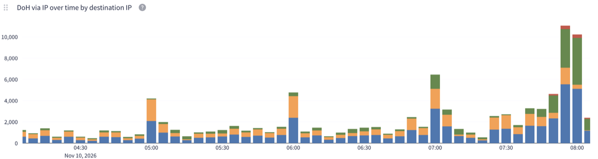

<section data-lang="de" class="language-content active" markdown="1">

**Kurz gesagt:** Wer unsere DNS-Server nutzt, ist ab sofort noch privater unterwegs. Viele moderne Geräte erkennen jetzt von selbst, dass sie mit uns verschlüsselt sprechen können, und schalten automatisch um. **Du musst dafür nichts einstellen.**

> 👉 **Noch nicht dabei?** Unser DNS ist **kostenlos, ohne Anmeldung** und für alle offen. In wenigen Minuten auf Handy, Laptop oder Router eingerichtet: **[dns-setup.ffmuc.net](https://dns-setup.ffmuc.net)**

## Worum geht es?

Bevor dein Gerät eine Webseite lädt, fragt es einen DNS-Server nach deren Adresse. Das ist wie ein Blick ins Telefonbuch. Normalerweise passiert das **unverschlüsselt**. Jeder auf dem Weg kann mitlesen, welche Seiten du besuchst, oder die Antwort verfälschen.

**Verschlüsseltes DNS** schützt diese Anfragen. Wir bieten es schon lange an. Bisher musste man es aber meist von Hand einrichten. Viele Geräte kennen nur die IP-Adresse unseres DNS-Servers, zum Beispiel weil der Router sie verteilt. Dann fragen sie unverschlüsselt.

## So schaltet dein Gerät automatisch um

Das Verfahren dafür heißt **DDR** („Discovery of Designated Resolvers“). Am Beispiel unserer Server sieht das so aus:

1. **Adresse bekommen:** Dein Router sagt deinem Gerät: „Dein DNS-Server ist `5.1.66.255`“ (oder `2001:678:e68:f000::`). Mehr weiß das Gerät noch nicht.
2. **Nachfragen:** Das Gerät fragt `5.1.66.255` (oder `2001:678:e68:f000::`): „Kannst du auch verschlüsselt?“ Technisch ist das eine Anfrage nach `_dns.resolver.arpa`.
3. **Antwort bekommen:** Wir antworten: „Ja! Über `doq.ffmuc.net`, `dot.ffmuc.net` und `doh.ffmuc.net`, erreichbar unter `5.1.66.255`, `185.150.99.255`, `2001:678:e68:f000::` und `2001:678:ed0:f000::`.“
4. **Identität prüfen:** Das Gerät baut eine verschlüsselte Verbindung zu `5.1.66.255` (oder `2001:678:e68:f000::`) auf, zum Beispiel mit dem Namen `dot.ffmuc.net`. Unser Zertifikat zeigt die **Identität** des Servers: die Namen `doh.ffmuc.net`, `dot.ffmuc.net` und `doq.ffmuc.net` **und alle unsere Adressen: `5.1.66.255`, `185.150.99.255`, `2001:678:e68:f000::` und `2001:678:ed0:f000::`**. Das Gerät vergleicht: Ist das wirklich der Server, den ich am Anfang gefragt habe? Die Adresse, mit der das Gerät angefangen hat, steht darin. Also spricht es nicht mit einem Angreifer.
5. **Umschalten:** Alles passt. Ab jetzt nutzt das Gerät automatisch verschlüsseltes DNS.

```
Router ─▶ Gerät   „Dein DNS ist 5.1.66.255
                   oder 2001:678:e68:f000::“
Gerät  ─▶ FFMUC   „Kannst du verschlüsselt?“
FFMUC  ─▶ Gerät   „Ja: dot.ffmuc.net, auch unter
                   5.1.66.255, 185.150.99.255,
                   2001:678:e68:f000::, 2001:678:ed0:f000::“
Gerät  ═▶ FFMUC   verschlüsselt, Name dot.ffmuc.net
Identität im Zertifikat (neu!):
   dot.ffmuc.net ✔  5.1.66.255 ✔  2001:678:e68:f000:: ✔
Gerät  ═▶ ab jetzt verschlüsseltes DNS
```

## Was ist neu?

Die Schritte 1 bis 3 bieten wir [schon seit Januar](/services/dns/2026/01/09/rfc9462-rfc9463-support/) an. **Schritt 4 hat bisher nicht geklappt:** In unserem Zertifikat standen nur Namen wie `doh.ffmuc.net`, aber nicht unsere IP-Adressen. Die Geräte konnten also nicht sicher prüfen, ob sie noch mit uns sprechen, und blieben lieber beim unverschlüsselten DNS.

**Jetzt stehen auch unsere IP-Adressen im Zertifikat.** Damit klappt die Prüfung, und das Gerät schaltet um. Möglich ist das erst seit 2026: Seitdem stellt Let's Encrypt Zertifikate für IP-Adressen aus. Sie gelten nur wenige Tage und werden automatisch erneuert.



*DoH-Anfragen, die direkt an unsere Resolver-IP-Adressen gehen (letzte 4 Stunden). Der Anstieg beginnt, nachdem das neue Zertifikat live gegangen ist. Orange: `5.1.66.255`, grün: `185.150.99.255`, rot: `2001:678:ed0:f000::`, blau: alle übrigen Anfragen. Gezählt werden alle Geräte, die uns über eine IP-Adresse ansprechen, nicht nur Geräte, die automatisch umgeschaltet haben.*

Im Freifunk-Netz geht es übrigens noch direkter: Dort sagt das Netz deinem Gerät schon beim Verbinden, dass verschlüsseltes DNS bereitsteht (DNR). Geräte, die das unterstützen, müssen also gar nicht erst nachfragen.

## Welche Geräte machen das?

DDR unterstützen zum Beispiel aktuelle Versionen von Windows 11 und Apple-Geräten sowie manche Android-Versionen und Browser. Ob ein Gerät wirklich umschaltet, hängt vom System und seinen Einstellungen ab.

## Was musst du tun?

- **Nichts.** Es wird einfach sicherer.
- Nutzt du schon `doh.ffmuc.net`, `dot.ffmuc.net` oder `doq.ffmuc.net`, bleibt alles wie bisher.
- Freifunk-Router und Firmware-Updates sind nicht betroffen.

## Jetzt umsteigen: privates DNS von Freifunk München

Warum unser DNS?

- **Kostenlos und ohne Anmeldung:** für alle, nicht nur im Freifunk-Netz.
- **Datenschutzfreundlich:** Wir speichern keine Protokolle darüber, wer welche Seite aufruft, und verkaufen oder teilen keine DNS-Daten.
- **Keine Zensur:** Wir filtern keine Inhalte.
- **Verschlüsselt** mit DoH, DoT und DoQ.
- **Gemeinnützig:** betrieben vom Verein Freie Netze München e.V., gelistet auf [European Alternatives](https://european-alternatives.eu/de/produkt/ffmuc-dns).

**👉 [Jetzt einrichten auf dns-setup.ffmuc.net](https://dns-setup.ffmuc.net)**: mit einfachen Anleitungen für Windows, macOS, iPhone, Android, Linux, Browser und Router.

## Für Technik-Interessierte

- **Anycast-IPs:** `185.150.99.255`, `5.1.66.255`, `2001:678:e68:f000::`, `2001:678:ed0:f000::`
- **DoH:** `https://doh.ffmuc.net/dns-query` · **DoT:** `dot.ffmuc.net:853` · **DoQ:** `doq.ffmuc.net:853`
- **DDR-Antwort** auf `_dns.resolver.arpa` (Typ SVCB): DoQ (Priorität 1), DoT (Priorität 2), DoH (Priorität 3), jeweils mit `ipv4hint` (`5.1.66.255`, `185.150.99.255`) und `ipv6hint` (`2001:678:e68:f000::`, `2001:678:ed0:f000::`).
- Das neue Let's-Encrypt-Zertifikat enthält alle vier Anycast-Adressen (IPv4 und IPv6) als IP-SANs, zusätzlich zu `doh`, `dns`, `dot`, `doq`, `anycast`, `anycast01` und `anycast02.ffmuc.net`. Laufzeit etwa 6 Tage, automatische Erneuerung.
- Die IP-Adressen werden per HTTP-Challenge bestätigt. Da Anycast die Prüfung an jeden unserer Server schicken kann, teilen die Server die Antwort untereinander.
- Das bestehende `*.ffmuc.net`-Zertifikat bleibt der Standard.
- [Pull Request #697: Kurzlebiges DDR-Zertifikat mit Anycast-IP-Adressen](https://github.com/freifunkMUC/ffmuc-salt-public/pull/697)
- [RFC 9462: Discovery of Designated Resolvers](https://www.rfc-editor.org/rfc/rfc9462.html) · [RFC 9463: DNR](https://datatracker.ietf.org/doc/rfc9463/)
- [Datenschutzerklärung DNS](/dns-privacy)

</section>

<section data-lang="en" class="language-content" markdown="1">

**In short:** If you use our DNS servers, you are now even more private. Many modern devices now find out by themselves that they can talk to us encrypted, and switch over automatically. **You do not have to change any setting.**

> 👉 **Not using it yet?** Our DNS is **free, with no sign-up**, and open to everyone. Set it up on your phone, laptop or router in a few minutes: **[dns-setup.ffmuc.net](https://dns-setup.ffmuc.net)**

## What is this about?

Before your device loads a website, it asks a DNS server for the site's address. This is like looking it up in a phone book. Usually this happens **unencrypted**. Anyone along the way can see which sites you visit, or change the answer.

**Encrypted DNS** protects these requests. We have offered it for a long time. But until now, you usually had to set it up by hand. Many devices only know the IP address of our DNS server, for example because the router hands it out. Then they ask unencrypted.

## How your device switches automatically

The method is called **DDR** ("Discovery of Designated Resolvers"). With our servers as an example, it works like this:

1. **Get the address:** Your router tells your device: "Your DNS server is `5.1.66.255`" (or `2001:678:e68:f000::`). The device knows nothing more yet.
2. **Ask:** The device asks `5.1.66.255` (or `2001:678:e68:f000::`): "Can you also talk encrypted?" Technically, this is a query for `_dns.resolver.arpa`.
3. **Get the answer:** We answer: "Yes! Use `doq.ffmuc.net`, `dot.ffmuc.net` and `doh.ffmuc.net`, reachable at `5.1.66.255`, `185.150.99.255`, `2001:678:e68:f000::` and `2001:678:ed0:f000::`."
4. **Check the identity:** The device opens an encrypted connection to `5.1.66.255` (or `2001:678:e68:f000::`), for example with the name `dot.ffmuc.net`. Our certificate shows the **identity** of the server: the names `doh.ffmuc.net`, `dot.ffmuc.net` and `doq.ffmuc.net` **and all our addresses: `5.1.66.255`, `185.150.99.255`, `2001:678:e68:f000::` and `2001:678:ed0:f000::`**. The device compares: is this really the server I asked at the start? The address the device started with is in it. So it is not talking to an attacker.
5. **Switch:** Everything matches. From now on, the device uses encrypted DNS automatically.

```
Router ─▶ device  "Your DNS is 5.1.66.255
                   or 2001:678:e68:f000::"
device ─▶ FFMUC   "Can you talk encrypted?"
FFMUC  ─▶ device  "Yes: dot.ffmuc.net, also at
                   5.1.66.255, 185.150.99.255,
                   2001:678:e68:f000::, 2001:678:ed0:f000::"
device ═▶ FFMUC   encrypted, name dot.ffmuc.net
Identity in certificate (new!):
   dot.ffmuc.net ✔  5.1.66.255 ✔  2001:678:e68:f000:: ✔
device ═▶ encrypted DNS from now on
```

## What is new?

We have offered steps 1 to 3 [since January](/services/dns/2026/01/09/rfc9462-rfc9463-support/). **But step 4 did not work:** Our certificate only contained names like `doh.ffmuc.net`, not our IP addresses. So devices could not safely check that they were still talking to us, and stayed on unencrypted DNS.

**Now our IP addresses are in the certificate, too.** The check passes, and the device switches over. This is only possible since 2026: since then, Let's Encrypt issues certificates for IP addresses. They are valid for a few days only and renew automatically.


*DoH requests sent directly to our resolver IP addresses (last 4 hours). The rise starts after the new certificate went live. Orange: `5.1.66.255`, green: `185.150.99.255`, red: `2001:678:ed0:f000::`, blue: all other requests. The chart counts every client that uses an IP address, not only devices that switched automatically.*

In the Freifunk network it is even more direct: there, the network tells your device right when it connects that encrypted DNS is available (DNR). Devices that support this do not even need to ask.

## Which devices do this?

DDR is supported, for example, by recent versions of Windows 11 and Apple devices, and by some Android versions and browsers. Whether a device really switches depends on the system and its settings.

## What do you have to do?

- **Nothing.** It simply gets safer.
- If you already use `doh.ffmuc.net`, `dot.ffmuc.net` or `doq.ffmuc.net`, nothing changes.
- Freifunk routers and firmware updates are not affected.

## Switch now: private DNS from Freifunk München

Why our DNS?

- **Free and no sign-up:** for everyone, not only in the Freifunk network.
- **Privacy-friendly:** We do not keep logs of who visits which site, and we do not sell or share DNS data.
- **No censorship:** We do not filter content.
- **Encrypted** with DoH, DoT and DoQ.
- **Non-profit:** run by the association Freie Netze München e.V., listed on [European Alternatives](https://european-alternatives.eu/product/ffmuc-dns).

**👉 [Set it up now at dns-setup.ffmuc.net](https://dns-setup.ffmuc.net)**, with easy guides for Windows, macOS, iPhone, Android, Linux, browsers and routers.

## For the technically curious

- **Anycast IPs:** `185.150.99.255`, `5.1.66.255`, `2001:678:e68:f000::`, `2001:678:ed0:f000::`
- **DoH:** `https://doh.ffmuc.net/dns-query` · **DoT:** `dot.ffmuc.net:853` · **DoQ:** `doq.ffmuc.net:853`
- **DDR answer** for `_dns.resolver.arpa` (type SVCB): DoQ (priority 1), DoT (priority 2), DoH (priority 3), each with `ipv4hint` (`5.1.66.255`, `185.150.99.255`) and `ipv6hint` (`2001:678:e68:f000::`, `2001:678:ed0:f000::`).
- The new Let's Encrypt certificate contains all four anycast addresses (IPv4 and IPv6) as IP SANs, in addition to `doh`, `dns`, `dot`, `doq`, `anycast`, `anycast01` and `anycast02.ffmuc.net`. Lifetime about 6 days, automatic renewal.
- The IP addresses are validated with an HTTP challenge. Because anycast can send the check to any of our servers, the servers share the answer with each other.
- The existing `*.ffmuc.net` certificate stays the default.
- [Pull Request #697: Short-lived DDR certificate with anycast IP addresses](https://github.com/freifunkMUC/ffmuc-salt-public/pull/697)
- [RFC 9462: Discovery of Designated Resolvers](https://www.rfc-editor.org/rfc/rfc9462.html) · [RFC 9463: DNR](https://datatracker.ietf.org/doc/rfc9463/)
- [DNS privacy policy](/dns-privacy)

</section>

<section data-lang="fr" class="language-content" markdown="1">

**En bref :** Si vous utilisez nos serveurs DNS, votre vie privée est désormais encore mieux protégée. De nombreux appareils modernes découvrent maintenant d'eux-mêmes qu'ils peuvent communiquer avec nous de façon chiffrée, et basculent automatiquement. **Vous n'avez aucun réglage à faire.**

> 👉 **Pas encore utilisateur ?** Notre DNS est **gratuit, sans inscription** et ouvert à toutes et tous. Configurez-le en quelques minutes sur votre téléphone, ordinateur ou routeur : **[dns-setup.ffmuc.net](https://dns-setup.ffmuc.net)**

## De quoi s'agit-il ?

Avant de charger un site web, votre appareil demande son adresse à un serveur DNS, comme on cherche un numéro dans un annuaire. En général, cela se fait **sans chiffrement**. N'importe qui sur le chemin peut voir quels sites vous visitez, ou modifier la réponse.

Le **DNS chiffré** protège ces requêtes. Nous le proposons depuis longtemps. Mais jusqu'ici, il fallait le plus souvent le configurer à la main. Beaucoup d'appareils ne connaissent que l'adresse IP de notre serveur DNS, par exemple parce que le routeur la leur donne. Ils posent alors leurs questions sans chiffrement.

## Comment votre appareil bascule automatiquement

La méthode s'appelle **DDR** (« Discovery of Designated Resolvers »). Avec nos serveurs comme exemple, cela se passe ainsi :

1. **Recevoir l'adresse :** Votre routeur dit à votre appareil : « Ton serveur DNS est `5.1.66.255` » (ou `2001:678:e68:f000::`). L'appareil n'en sait pas plus pour l'instant.
2. **Demander :** L'appareil demande à `5.1.66.255` (ou `2001:678:e68:f000::`) : « Sais-tu aussi parler de façon chiffrée ? » Techniquement, c'est une requête pour `_dns.resolver.arpa`.
3. **Recevoir la réponse :** Nous répondons : « Oui ! Via `doq.ffmuc.net`, `dot.ffmuc.net` et `doh.ffmuc.net`, joignables à `5.1.66.255`, `185.150.99.255`, `2001:678:e68:f000::` et `2001:678:ed0:f000::`. »
4. **Vérifier l'identité :** L'appareil ouvre une connexion chiffrée vers `5.1.66.255` (ou `2001:678:e68:f000::`), par exemple avec le nom `dot.ffmuc.net`. Notre certificat montre l'**identité** du serveur : les noms `doh.ffmuc.net`, `dot.ffmuc.net` et `doq.ffmuc.net` **et toutes nos adresses : `5.1.66.255`, `185.150.99.255`, `2001:678:e68:f000::` et `2001:678:ed0:f000::`**. L'appareil compare : est-ce vraiment le serveur que j'ai interrogé au début ? L'adresse avec laquelle l'appareil a commencé y figure : il ne parle donc pas à un attaquant.
5. **Basculer :** Tout correspond. Désormais, l'appareil utilise automatiquement le DNS chiffré.

```
Routeur  ─▶ appareil  « Ton DNS est 5.1.66.255
                       ou 2001:678:e68:f000:: »
appareil ─▶ FFMUC     « Chiffré possible ? »
FFMUC    ─▶ appareil  « Oui : dot.ffmuc.net, aussi à
                       5.1.66.255, 185.150.99.255,
                       2001:678:e68:f000::, 2001:678:ed0:f000:: »
appareil ═▶ FFMUC     chiffré, nom dot.ffmuc.net
Identité du certificat (nouveau !) :
   dot.ffmuc.net ✔  5.1.66.255 ✔  2001:678:e68:f000:: ✔
appareil ═▶ désormais DNS chiffré
```

## Quoi de neuf ?

Nous proposons les étapes 1 à 3 [depuis janvier](/services/dns/2026/01/09/rfc9462-rfc9463-support/). **Mais l'étape 4 ne fonctionnait pas :** notre certificat ne contenait que des noms comme `doh.ffmuc.net`, pas nos adresses IP. Les appareils ne pouvaient donc pas vérifier de façon sûre qu'ils parlaient toujours avec nous, et restaient sur le DNS non chiffré.

**Désormais, nos adresses IP figurent aussi dans le certificat.** La vérification réussit, et l'appareil bascule. Ce n'est possible que depuis 2026 : depuis, Let's Encrypt délivre des certificats pour des adresses IP. Ils ne sont valables que quelques jours et se renouvellent automatiquement.


*Requêtes DoH envoyées directement aux adresses IP de nos résolveurs (4 dernières heures). La hausse commence après la mise en service du nouveau certificat. Orange : `5.1.66.255`, vert : `185.150.99.255`, rouge : `2001:678:ed0:f000::`, bleu : toutes les autres requêtes. Le graphique compte tous les clients qui utilisent une adresse IP, pas seulement les appareils qui ont basculé automatiquement.*

Dans le réseau Freifunk, c'est même encore plus direct : le réseau indique à votre appareil, dès la connexion, que le DNS chiffré est disponible (DNR). Les appareils compatibles n'ont même pas besoin de demander.

## Quels appareils le font ?

DDR est pris en charge, par exemple, par les versions récentes de Windows 11 et des appareils Apple, ainsi que par certaines versions d'Android et certains navigateurs. Le basculement dépend du système et de ses réglages.

## Que devez-vous faire ?

- **Rien.** C'est simplement plus sûr.
- Si vous utilisez déjà `doh.ffmuc.net`, `dot.ffmuc.net` ou `doq.ffmuc.net`, rien ne change.
- Les routeurs Freifunk et les mises à jour du firmware ne sont pas concernés.

## Passez-y maintenant : le DNS privé de Freifunk Munich

Pourquoi notre DNS ?

- **Gratuit et sans inscription :** pour tout le monde, pas seulement dans le réseau Freifunk.
- **Respectueux de la vie privée :** Nous ne gardons pas de journaux indiquant qui visite quel site, et nous ne vendons ni ne partageons de données DNS.
- **Pas de censure :** Nous ne filtrons aucun contenu.
- **Chiffré** avec DoH, DoT et DoQ.
- **À but non lucratif :** exploité par l'association Freie Netze München e.V., listé sur [European Alternatives](https://european-alternatives.eu/product/ffmuc-dns).

**👉 [Configurez-le maintenant sur dns-setup.ffmuc.net](https://dns-setup.ffmuc.net)**, avec des guides simples pour Windows, macOS, iPhone, Android, Linux, les navigateurs et les routeurs.

## Pour les curieux de technique

- **IP anycast :** `185.150.99.255`, `5.1.66.255`, `2001:678:e68:f000::`, `2001:678:ed0:f000::`
- **DoH :** `https://doh.ffmuc.net/dns-query` · **DoT :** `dot.ffmuc.net:853` · **DoQ :** `doq.ffmuc.net:853`
- **Réponse DDR** pour `_dns.resolver.arpa` (type SVCB) : DoQ (priorité 1), DoT (priorité 2), DoH (priorité 3), chacun avec `ipv4hint` (`5.1.66.255`, `185.150.99.255`) et `ipv6hint` (`2001:678:e68:f000::`, `2001:678:ed0:f000::`).
- Le nouveau certificat Let's Encrypt contient les quatre adresses anycast (IPv4 et IPv6) comme IP SAN, en plus de `doh`, `dns`, `dot`, `doq`, `anycast`, `anycast01` et `anycast02.ffmuc.net`. Durée de validité d'environ 6 jours, renouvellement automatique.
- Les adresses IP sont validées par un challenge HTTP. Comme l'anycast peut envoyer la vérification à n'importe lequel de nos serveurs, les serveurs partagent la réponse entre eux.
- Le certificat existant `*.ffmuc.net` reste le certificat par défaut.
- [Pull Request #697 : certificat DDR de courte durée avec adresses IP anycast](https://github.com/freifunkMUC/ffmuc-salt-public/pull/697)
- [RFC 9462 : Discovery of Designated Resolvers](https://www.rfc-editor.org/rfc/rfc9462.html) · [RFC 9463 : DNR](https://datatracker.ietf.org/doc/rfc9463/)
- [Politique de confidentialité DNS](/dns-privacy)

</section>

<section data-lang="es" class="language-content" markdown="1">

**En resumen:** Si usas nuestros servidores DNS, tu privacidad está ahora aún mejor protegida. Muchos dispositivos modernos descubren ahora por sí solos que pueden hablar con nosotros de forma cifrada, y cambian automáticamente. **No tienes que cambiar ningún ajuste.**

> 👉 **¿Aún no lo usas?** Nuestro DNS es **gratuito, sin registro** y abierto a todo el mundo. Configúralo en pocos minutos en tu móvil, portátil o router: **[dns-setup.ffmuc.net](https://dns-setup.ffmuc.net)**

## ¿De qué se trata?

Antes de cargar una página web, tu dispositivo pregunta su dirección a un servidor DNS, como quien busca un número en la guía telefónica. Normalmente esto ocurre **sin cifrar**. Cualquiera en el camino puede ver qué sitios visitas o cambiar la respuesta.

El **DNS cifrado** protege estas consultas. Lo ofrecemos desde hace mucho tiempo. Pero hasta ahora, casi siempre había que configurarlo a mano. Muchos dispositivos solo conocen la dirección IP de nuestro servidor DNS, por ejemplo porque se la da el router, y entonces preguntan sin cifrar.

## Así cambia tu dispositivo automáticamente

El método se llama **DDR** («Discovery of Designated Resolvers»). Con nuestros servidores como ejemplo, funciona así:

1. **Recibir la dirección:** Tu router le dice a tu dispositivo: «Tu servidor DNS es `5.1.66.255`» (o `2001:678:e68:f000::`). El dispositivo todavía no sabe nada más.
2. **Preguntar:** El dispositivo pregunta a `5.1.66.255` (o `2001:678:e68:f000::`): «¿Puedes hablar también de forma cifrada?» Técnicamente, es una consulta de `_dns.resolver.arpa`.
3. **Recibir la respuesta:** Respondemos: «¡Sí! A través de `doq.ffmuc.net`, `dot.ffmuc.net` y `doh.ffmuc.net`, accesibles en `5.1.66.255`, `185.150.99.255`, `2001:678:e68:f000::` y `2001:678:ed0:f000::`.»
4. **Comprobar la identidad:** El dispositivo abre una conexión cifrada con `5.1.66.255` (o `2001:678:e68:f000::`), por ejemplo con el nombre `dot.ffmuc.net`. Nuestro certificado muestra la **identidad** del servidor: los nombres `doh.ffmuc.net`, `dot.ffmuc.net` y `doq.ffmuc.net` **y todas nuestras direcciones: `5.1.66.255`, `185.150.99.255`, `2001:678:e68:f000::` y `2001:678:ed0:f000::`**. El dispositivo compara: ¿es de verdad el servidor al que pregunté al principio? La dirección con la que empezó el dispositivo está ahí, así que no está hablando con un atacante.
5. **Cambiar:** Todo coincide. A partir de ahora, el dispositivo usa DNS cifrado automáticamente.

```
Router      ─▶ dispositivo  «Tu DNS es 5.1.66.255
                            o 2001:678:e68:f000::»
dispositivo ─▶ FFMUC        «¿Puedes cifrar?»
FFMUC       ─▶ dispositivo  «Sí: dot.ffmuc.net, también en
                            5.1.66.255, 185.150.99.255,
                            2001:678:e68:f000::, 2001:678:ed0:f000::»
dispositivo ═▶ FFMUC        cifrado, nombre dot.ffmuc.net
Identidad del certificado (¡nuevo!):
   dot.ffmuc.net ✔  5.1.66.255 ✔  2001:678:e68:f000:: ✔
dispositivo ═▶ DNS cifrado a partir de ahora
```

## ¿Qué hay de nuevo?

Ofrecemos los pasos 1 a 3 [desde enero](/services/dns/2026/01/09/rfc9462-rfc9463-support/). **Pero el paso 4 no funcionaba:** nuestro certificado solo contenía nombres como `doh.ffmuc.net`, no nuestras direcciones IP. Así que los dispositivos no podían comprobar con seguridad que seguían hablando con nosotros, y se quedaban con el DNS sin cifrar.

**Ahora nuestras direcciones IP también están en el certificado.** La comprobación funciona y el dispositivo cambia. Esto solo es posible desde 2026: desde entonces, Let's Encrypt emite certificados para direcciones IP. Son válidos solo unos pocos días y se renuevan automáticamente.


*Solicitudes DoH enviadas directamente a las direcciones IP de nuestros resolvers (últimas 4 horas). El aumento empieza después de que el nuevo certificado entrara en servicio. Naranja: `5.1.66.255`, verde: `185.150.99.255`, rojo: `2001:678:ed0:f000::`, azul: el resto de solicitudes. El gráfico cuenta todos los clientes que usan una dirección IP, no solo los dispositivos que cambiaron automáticamente.*

En la red Freifunk es incluso más directo: allí la red le dice a tu dispositivo, nada más conectarse, que hay DNS cifrado disponible (DNR). Los dispositivos compatibles ni siquiera necesitan preguntar.

## ¿Qué dispositivos lo hacen?

DDR es compatible, por ejemplo, con versiones recientes de Windows 11 y de dispositivos Apple, y con algunas versiones de Android y algunos navegadores. Que un dispositivo cambie de verdad depende del sistema y de su configuración.

## ¿Qué tienes que hacer?

- **Nada.** Simplemente es más seguro.
- Si ya usas `doh.ffmuc.net`, `dot.ffmuc.net` o `doq.ffmuc.net`, todo sigue igual.
- Los routers Freifunk y las actualizaciones de firmware no se ven afectados.

## Cámbiate ahora: DNS privado de Freifunk Múnich

¿Por qué nuestro DNS?

- **Gratuito y sin registro:** para todo el mundo, no solo en la red Freifunk.
- **Respetuoso con la privacidad:** No guardamos registros de quién visita qué sitio, y no vendemos ni compartimos datos DNS.
- **Sin censura:** No filtramos contenidos.
- **Cifrado** con DoH, DoT y DoQ.
- **Sin ánimo de lucro:** gestionado por la asociación Freie Netze München e.V., incluido en [European Alternatives](https://european-alternatives.eu/product/ffmuc-dns).

**👉 [Configúralo ahora en dns-setup.ffmuc.net](https://dns-setup.ffmuc.net)**, con guías sencillas para Windows, macOS, iPhone, Android, Linux, navegadores y routers.

## Para los curiosos de la técnica

- **IP anycast:** `185.150.99.255`, `5.1.66.255`, `2001:678:e68:f000::`, `2001:678:ed0:f000::`
- **DoH:** `https://doh.ffmuc.net/dns-query` · **DoT:** `dot.ffmuc.net:853` · **DoQ:** `doq.ffmuc.net:853`
- **Respuesta DDR** para `_dns.resolver.arpa` (tipo SVCB): DoQ (prioridad 1), DoT (prioridad 2), DoH (prioridad 3), cada uno con `ipv4hint` (`5.1.66.255`, `185.150.99.255`) e `ipv6hint` (`2001:678:e68:f000::`, `2001:678:ed0:f000::`).
- El nuevo certificado de Let's Encrypt contiene las cuatro direcciones anycast (IPv4 e IPv6) como IP SAN, además de `doh`, `dns`, `dot`, `doq`, `anycast`, `anycast01` y `anycast02.ffmuc.net`. Validez de unos 6 días, renovación automática.
- Las direcciones IP se validan con un desafío HTTP. Como anycast puede enviar la comprobación a cualquiera de nuestros servidores, los servidores comparten la respuesta entre sí.
- El certificado existente `*.ffmuc.net` sigue siendo el predeterminado.
- [Pull Request #697: certificado DDR de corta duración con direcciones IP anycast](https://github.com/freifunkMUC/ffmuc-salt-public/pull/697)
- [RFC 9462: Discovery of Designated Resolvers](https://www.rfc-editor.org/rfc/rfc9462.html) · [RFC 9463: DNR](https://datatracker.ietf.org/doc/rfc9463/)
- [Política de privacidad DNS](/dns-privacy)

</section>

<section data-lang="ua" class="language-content" markdown="1">

**Коротко:** Якщо ви користуєтеся нашими DNS-серверами, ваша приватність тепер захищена ще краще. Багато сучасних пристроїв тепер самі дізнаються, що можуть спілкуватися з нами зашифровано, і автоматично перемикаються. **Вам не потрібно нічого налаштовувати.**

> 👉 **Ще не користуєтеся?** Наш DNS **безкоштовний, без реєстрації** і відкритий для всіх. Налаштуйте його за кілька хвилин на телефоні, ноутбуці чи маршрутизаторі: **[dns-setup.ffmuc.net](https://dns-setup.ffmuc.net)**

## Про що йдеться?

Перш ніж завантажити вебсторінку, ваш пристрій запитує її адресу в DNS-сервера, наче шукає номер у телефонній книзі. Зазвичай це відбувається **без шифрування**. Будь-хто на шляху може бачити, які сайти ви відвідуєте, або підмінити відповідь.

**Зашифрований DNS** захищає ці запити. Ми давно його пропонуємо. Але досі його зазвичай доводилося налаштовувати вручну. Багато пристроїв знають лише IP-адресу нашого DNS-сервера, наприклад тому, що її роздає маршрутизатор. Тоді вони запитують без шифрування.

## Як ваш пристрій перемикається автоматично

Цей метод називається **DDR** («Discovery of Designated Resolvers»). На прикладі наших серверів це виглядає так:

1. **Отримати адресу:** Ваш маршрутизатор каже пристрою: «Твій DNS-сервер: `5.1.66.255`» (або `2001:678:e68:f000::`). Більше пристрій поки нічого не знає.
2. **Запитати:** Пристрій запитує `5.1.66.255` (або `2001:678:e68:f000::`): «Чи можеш ти спілкуватися зашифровано?» Технічно це запит `_dns.resolver.arpa`.
3. **Отримати відповідь:** Ми відповідаємо: «Так! Через `doq.ffmuc.net`, `dot.ffmuc.net` і `doh.ffmuc.net`, доступні за адресами `5.1.66.255`, `185.150.99.255`, `2001:678:e68:f000::` і `2001:678:ed0:f000::`.»
4. **Перевірити ідентичність:** Пристрій відкриває зашифроване з'єднання з `5.1.66.255` (або `2001:678:e68:f000::`), наприклад з іменем `dot.ffmuc.net`. Наш сертифікат показує **ідентичність** сервера: імена `doh.ffmuc.net`, `dot.ffmuc.net` і `doq.ffmuc.net` **та всі наші адреси: `5.1.66.255`, `185.150.99.255`, `2001:678:e68:f000::` і `2001:678:ed0:f000::`**. Пристрій порівнює: чи це справді той сервер, якого я запитав на початку? Адреса, з якої пристрій почав, там є. Отже, він не спілкується з нападником.
5. **Перемкнутися:** Усе збігається. Відтепер пристрій автоматично використовує зашифрований DNS.

```
Маршрутизатор ─▶ пристрій  «Твій DNS: 5.1.66.255
                            або 2001:678:e68:f000::»
пристрій      ─▶ FFMUC     «Можеш зашифровано?»
FFMUC         ─▶ пристрій  «Так: dot.ffmuc.net, також на
                            5.1.66.255, 185.150.99.255,
                            2001:678:e68:f000::, 2001:678:ed0:f000::»
пристрій      ═▶ FFMUC     зашифровано, ім'я dot.ffmuc.net
Ідентичність у сертифікаті (нове!):
   dot.ffmuc.net ✔  5.1.66.255 ✔  2001:678:e68:f000:: ✔
пристрій      ═▶ відтепер зашифрований DNS
```

## Що нового?

Кроки з 1 по 3 ми пропонуємо [ще з січня](/services/dns/2026/01/09/rfc9462-rfc9463-support/). **Але крок 4 не працював:** у нашому сертифікаті були лише імена на кшталт `doh.ffmuc.net`, а не наші IP-адреси. Тож пристрої не могли надійно перевірити, що досі спілкуються з нами, і залишалися на незашифрованому DNS.

**Тепер наші IP-адреси теж є в сертифікаті.** Перевірка проходить, і пристрій перемикається. Це можливо лише з 2026 року: відтоді Let's Encrypt видає сертифікати для IP-адрес. Вони дійсні лише кілька днів і оновлюються автоматично.


*Запити DoH, що надходять безпосередньо на IP-адреси наших резолверів (останні 4 години). Зростання починається після запуску нового сертифіката. Помаранчевий: `5.1.66.255`, зелений: `185.150.99.255`, червоний: `2001:678:ed0:f000::`, синій: усі інші запити. Діаграма враховує всіх клієнтів, які звертаються до нас за IP-адресою, а не лише пристрої, що перемкнулися автоматично.*

У мережі Freifunk усе ще простіше: там мережа одразу під час підключення повідомляє вашому пристрою, що зашифрований DNS доступний (DNR). Пристроям, які це підтримують, навіть не потрібно запитувати.

## Які пристрої це вміють?

DDR підтримують, наприклад, актуальні версії Windows 11 і пристроїв Apple, а також деякі версії Android і деякі браузери. Чи справді пристрій перемкнеться, залежить від системи та її налаштувань.

## Що вам потрібно зробити?

- **Нічого.** Просто стає безпечніше.
- Якщо ви вже використовуєте `doh.ffmuc.net`, `dot.ffmuc.net` або `doq.ffmuc.net`, нічого не змінюється.
- Маршрутизатори Freifunk та оновлення прошивки це не зачіпає.

## Переходьте вже зараз: приватний DNS від Freifunk München

Чому наш DNS?

- **Безкоштовно і без реєстрації:** для всіх, не лише в мережі Freifunk.
- **Дбає про приватність:** Ми не зберігаємо журнали про те, хто які сайти відвідує, і не продаємо та не передаємо DNS-дані.
- **Без цензури:** Ми не фільтруємо вміст.
- **Зашифровано** за допомогою DoH, DoT і DoQ.
- **Неприбутково:** працює завдяки об'єднанню Freie Netze München e.V., є в каталозі [European Alternatives](https://european-alternatives.eu/product/ffmuc-dns).

**👉 [Налаштуйте зараз на dns-setup.ffmuc.net](https://dns-setup.ffmuc.net)**, з простими інструкціями для Windows, macOS, iPhone, Android, Linux, браузерів і маршрутизаторів.

## Для тих, хто цікавиться технікою

- **Anycast IP:** `185.150.99.255`, `5.1.66.255`, `2001:678:e68:f000::`, `2001:678:ed0:f000::`
- **DoH:** `https://doh.ffmuc.net/dns-query` · **DoT:** `dot.ffmuc.net:853` · **DoQ:** `doq.ffmuc.net:853`
- **DDR-відповідь** на `_dns.resolver.arpa` (тип SVCB): DoQ (пріоритет 1), DoT (пріоритет 2), DoH (пріоритет 3), кожен з `ipv4hint` (`5.1.66.255`, `185.150.99.255`) та `ipv6hint` (`2001:678:e68:f000::`, `2001:678:ed0:f000::`).
- Новий сертифікат Let's Encrypt містить усі чотири anycast-адреси (IPv4 та IPv6) як IP SAN, окрім `doh`, `dns`, `dot`, `doq`, `anycast`, `anycast01` та `anycast02.ffmuc.net`. Термін дії близько 6 днів, автоматичне оновлення.
- IP-адреси підтверджуються через HTTP-перевірку. Оскільки anycast може надіслати перевірку на будь-який із наших серверів, сервери обмінюються відповіддю між собою.
- Наявний сертифікат `*.ffmuc.net` залишається стандартним.
- [Pull Request #697: короткостроковий DDR-сертифікат з anycast IP-адресами](https://github.com/freifunkMUC/ffmuc-salt-public/pull/697)
- [RFC 9462: Discovery of Designated Resolvers](https://www.rfc-editor.org/rfc/rfc9462.html) · [RFC 9463: DNR](https://datatracker.ietf.org/doc/rfc9463/)
- [Політика конфіденційності DNS](/dns-privacy)

</section>
