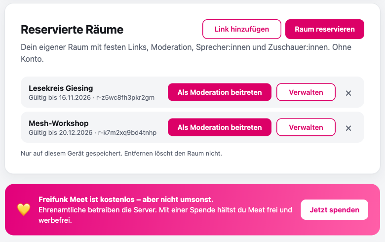
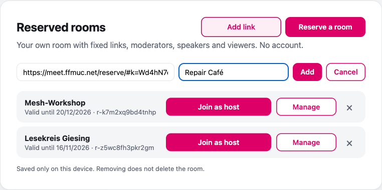
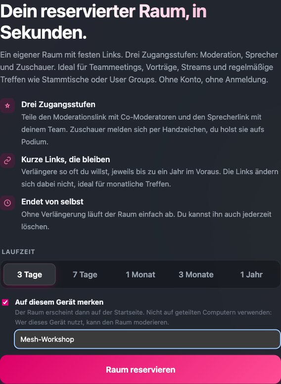

<section data-lang="de" class="language-content active" markdown="1">

**Liebe Freifunkerinnen und Freifunker,**

deine [reservierten Räume](/freifunkmuc/meet/2026/10/17/meet-zuschauer-raeume/) findest du jetzt direkt auf der Startseite von [meet.ffmuc.net](https://meet.ffmuc.net/). In der [Desktop-App](/freifunkmuc/meet/2026/11/01/meet-desktop-app-v2026-10-100/) gibt es das schon unter **Meine Räume**. Jetzt kann das auch der Browser. Außerdem haben wir in den letzten Tagen die Bildschirmfreigabe und die Verbindung verbessert.

**Neu: „Reservierte Räume“ auf der Startseite**

Auf der Startseite gibt es einen neuen Kasten **Reservierte Räume**. Er zeigt die Räume, die du auf diesem Gerät gespeichert hast. Zu jedem Raum siehst du:

- den **Namen**. Klicke auf den Namen, um ihn umzubenennen. Der Name gilt nur auf diesem Gerät.
- das Datum **Gültig bis**.
- **Als Moderation beitreten**.
- **Verwalten**. Endet der Raum in weniger als 3 Tagen, heißt der Knopf **Verlängern** und der Eintrag zeigt „Läuft in N Tagen ab“.
- **×** (Von diesem Gerät entfernen). Das entfernt den Raum nur aus der Liste. Der Raum selbst bleibt.

Mit **Link hinzufügen** fügst du einen Raum hinzu, den du schon hast. Füge einen Moderations- oder Verwaltungslink ein und gib optional einen Namen ein. Zuschauer- und Sprecherlinks funktionieren hier nicht.

Der Kasten prüft deine Räume regelmäßig. Ist ein Raum abgelaufen, gelöscht oder hat er neue Links, sagt dir der Kasten das.

**„Auf diesem Gerät merken“ beim Reservieren**

Auf [meet.ffmuc.net/reserve](https://meet.ffmuc.net/reserve/) gibt es das neue Häkchen **Auf diesem Gerät merken**. Es ist standardmäßig aus. Setzt du das Häkchen, kannst du dem Raum einen Namen geben, zum Beispiel „Vereinssitzung“. Der Raum erscheint dann auf der Startseite.

**Wichtig:** Nutze das nicht auf geteilten Computern. Wer dieses Gerät nutzt, kann den Raum moderieren.

**Deine Daten bleiben bei dir**

Die Liste liegt nur im Speicher deines Browsers (localStorage) auf diesem Gerät. Wir speichern dafür nichts zusätzlich auf unseren Servern. Dein eigener Name für den Raum geht nie an den Server. Ein anderer Browser oder ein anderes Gerät hat eine eigene Liste.

**Kostenlos, aber nicht umsonst**

Auf der Startseite gibt es jetzt auch einen kleinen Hinweis: „Freifunk Meet ist kostenlos, aber nicht umsonst. Ehrenamtliche betreiben die Server. Mit einer Spende hältst du Meet frei und werbefrei.“ Wenn dir Meet hilft, freuen wir uns über eine [Spende](https://ffmuc.net/spenden/).

**Weitere Verbesserungen**

- **Schärfere Bildschirmfreigabe:** Geteilte Bildschirme nutzen jetzt einen anderen Codec, mehr Bandbreite und bis zu 15 Bilder pro Sekunde. Scrollen und Videos laufen flüssiger. Bei schwachen Laptops oder schlechter Verbindung kann Text trotzdem noch unscharf werden. Danke an @nik@toot.teckids.org für den Hinweis!
- **Stabilere Verbindung:** Bei einem Verbindungsproblem baut Meet die Verbindung neu auf, ohne die Seite neu zu laden. Die alte Verbindung bleibt dabei aktiv, bis die neue bereit ist. In der Handy-App gilt das auch, wenn du zum Beispiel von WLAN auf Mobilfunk wechselst.
- **Weniger Daten bei Stille:** Wenn du nichts sagst, sendet dein Mikrofon keine Audiopakete.
- **Weniger verlorene Pakete:** Die Videoserver haben größere Puffer für ausgehende Daten.
- **Neues Design ohne Cache leeren:** Nach einem Update lädt die Startseite das neue Design. Du musst den Browser-Cache nicht mehr leeren.

**Für technisch Interessierte**

Alle Änderungen sind in [ffmuc-salt-public](https://github.com/freifunkMUC/ffmuc-salt-public):

- [#830](https://github.com/freifunkMUC/ffmuc-salt-public/pull/830): Kasten „Reservierte Räume“, Spenden-Banner, Häkchen „Auf diesem Gerät merken“
- [#826](https://github.com/freifunkMUC/ffmuc-salt-public/pull/826): Bildschirmfreigabe mit VP9, max. 5 Mbit/s, 15 fps
- [#827](https://github.com/freifunkMUC/ffmuc-salt-public/pull/827): Graceful Reconnect, ICE-Restart, SCTP-Bridge-Channel, Opus DTX
- [#828](https://github.com/freifunkMUC/ffmuc-salt-public/pull/828): UDP-Sendepuffer (sysctl) für die Videobridge
- [#833](https://github.com/freifunkMUC/ffmuc-salt-public/pull/833): Content-Hash an den FFMUC-Dateien (Cache-Busting)
- [#825](https://github.com/freifunkMUC/ffmuc-salt-public/pull/825): HAProxy-Logs mit UTC-ISO8601-Zeitstempel für Graylog

**Mehr dazu**

- Anleitung im Wiki: [Räume auf der Startseite](https://ffmuc.net/wiki/knb:meet#raeume_auf_der_startseite)
- [Desktop-App v2026.10.100 mit „Meine Räume“](/freifunkmuc/meet/2026/11/01/meet-desktop-app-v2026-10-100/)
- Jetzt ausprobieren: [meet.ffmuc.net/reserve](https://meet.ffmuc.net/reserve/)

Wir freuen uns über euer Feedback!

</section>

<section data-lang="en" class="language-content" markdown="1">

**Dear Freifunk community,**

You now find your [reserved rooms](/freifunkmuc/meet/2026/10/17/meet-zuschauer-raeume/) right on the start page of [meet.ffmuc.net](https://meet.ffmuc.net/). The [desktop app](/freifunkmuc/meet/2026/11/01/meet-desktop-app-v2026-10-100/) already has this in **My rooms**. Now the browser can do it too. In the last days we also made screen sharing and the connection better.

**New: "Reserved rooms" on the start page**

The start page has a new **Reserved rooms** box. It shows the rooms that you saved on this device. For each room you see:

- the **name**. Click the name to rename it. The name is only on this device.
- the **valid until** date.
- **Join as host**.
- **Manage**. When the room ends in less than 3 days, the button changes to **Extend** and the entry shows "expires in N days".
- **×** (remove from this device). This removes the room from the list only. The room itself stays.

With **Add link** you add a room that you already have. Paste a host link or a manage link and, if you want, a name. Viewer and speaker links do not work here.

The box checks your rooms regularly. If a room expired, was deleted or got new links, the box tells you.

**"Remember on this device" when you reserve**

On [meet.ffmuc.net/reserve](https://meet.ffmuc.net/reserve/) there is a new checkbox **Remember on this device**. It is off by default. When you tick it, you can give the room a name, for example "Club meeting". The room then shows on the start page.

**Important:** Do not use this on shared computers. Anyone who uses the device can host the room.

**Your data stays with you**

The list is only in your browser's storage (localStorage) on this device. We store nothing extra on our servers for it. Your own name for the room never goes to the server. Another browser or another device has its own list.

**Free, but not without cost**

The start page now also has a small note: "Freifunk Meet is free, but not without cost. Volunteers run the servers. With a donation you keep Meet free and ad-free." If Meet helps you, we are happy about a [donation](https://ffmuc.net/spenden/).

**Other improvements**

- **Sharper screen sharing:** Shared screens now use a different codec, more bandwidth and up to 15 frames per second. Scrolling and videos are smoother. On weak laptops or a bad connection, text can still get blurry. Thank you to @nik@toot.teckids.org for the report!
- **More stable connection:** When there is a connection problem, Meet connects again without a page reload. The old connection stays active until the new one is ready. The mobile app also does this when you change from Wi-Fi to mobile data, for example.
- **Less data in silence:** When you do not speak, your microphone sends no audio packets.
- **Fewer lost packets:** The video servers have larger buffers for outgoing data.
- **New design without clearing the cache:** After an update, the start page loads the new design. You do not have to clear the browser cache anymore.

**For technical readers**

All changes are in [ffmuc-salt-public](https://github.com/freifunkMUC/ffmuc-salt-public):

- [#830](https://github.com/freifunkMUC/ffmuc-salt-public/pull/830): "Reserved rooms" box, donation banner, "Remember on this device" checkbox
- [#826](https://github.com/freifunkMUC/ffmuc-salt-public/pull/826): screen share with VP9, max. 5 Mbps, 15 fps
- [#827](https://github.com/freifunkMUC/ffmuc-salt-public/pull/827): graceful reconnect, ICE restart, SCTP bridge channel, Opus DTX
- [#828](https://github.com/freifunkMUC/ffmuc-salt-public/pull/828): UDP send buffer sysctls for the videobridge
- [#833](https://github.com/freifunkMUC/ffmuc-salt-public/pull/833): content hash on FFMUC static file links (cache busting)
- [#825](https://github.com/freifunkMUC/ffmuc-salt-public/pull/825): HAProxy logs with UTC ISO8601 timestamps for Graylog

**More**

- Guide in the wiki: [Rooms on the start page](https://ffmuc.net/wiki/knb:meet-en#rooms_on_the_start_page)
- [Desktop app v2026.10.100 with "My rooms"](/freifunkmuc/meet/2026/11/01/meet-desktop-app-v2026-10-100/)
- Try it now: [meet.ffmuc.net/reserve](https://meet.ffmuc.net/reserve/)

We look forward to your feedback!

</section>

<section data-lang="fr" class="language-content" markdown="1">

**Chères Freifunkeuses, chers Freifunkeurs,**

Vos [salles réservées](/freifunkmuc/meet/2026/10/17/meet-zuschauer-raeume/) sont maintenant directement sur la page d'accueil de [meet.ffmuc.net](https://meet.ffmuc.net/). L'[application de bureau](/freifunkmuc/meet/2026/11/01/meet-desktop-app-v2026-10-100/) le propose déjà dans **Mes salles**. Maintenant, le navigateur le fait aussi. Ces derniers jours, nous avons aussi amélioré le partage d'écran et la connexion.

**Nouveau : « Salles réservées » sur la page d'accueil**

La page d'accueil a un nouveau bloc **Salles réservées** (affiché en allemand ou en anglais : « Reservierte Räume » / « Reserved rooms »). Il montre les salles que vous avez enregistrées sur cet appareil. Pour chaque salle, vous voyez :

- le **nom**. Cliquez sur le nom pour le modifier. Le nom reste uniquement sur cet appareil.
- la date **valable jusqu'au**.
- **Rejoindre en tant qu'hôte** (Join as host).
- **Gérer** (Manage). Si la salle expire dans moins de 3 jours, le bouton devient **Prolonger** (Extend) et l'entrée indique « expire dans N jours ».
- **×** (retirer de cet appareil). La salle est seulement retirée de la liste. La salle elle-même reste.

Avec **Ajouter un lien** (Add link), vous ajoutez une salle que vous avez déjà. Collez un lien d'hôte ou de gestion et, si vous voulez, un nom. Les liens de spectateur et d'intervenant ne fonctionnent pas ici.

Le bloc vérifie vos salles régulièrement. Si une salle a expiré, a été supprimée ou a de nouveaux liens, le bloc vous le dit.

**« Mémoriser sur cet appareil » lors de la réservation**

Sur [meet.ffmuc.net/reserve](https://meet.ffmuc.net/reserve/), il y a une nouvelle case **Mémoriser sur cet appareil**. Elle est désactivée par défaut. Si vous la cochez, vous pouvez donner un nom à la salle, par exemple « Réunion de l'association ». La salle apparaît alors sur la page d'accueil.

**Important :** n'utilisez pas cette option sur des ordinateurs partagés. Toute personne qui utilise l'appareil peut animer la salle.

**Vos données restent chez vous**

La liste est uniquement dans le stockage de votre navigateur (localStorage) sur cet appareil. Nous ne stockons rien de plus sur nos serveurs pour cela. Le nom que vous donnez à la salle n'est jamais envoyé au serveur. Un autre navigateur ou un autre appareil a sa propre liste.

**Gratuit, mais pas sans coût**

La page d'accueil affiche aussi un petit message : « Freifunk Meet est gratuit, mais pas sans coût. Des bénévoles font fonctionner les serveurs. Avec un don, vous gardez Meet libre et sans publicité. » Si Meet vous aide, nous serons heureux de recevoir un [don](https://ffmuc.net/spenden/).

**Autres améliorations**

- **Partage d'écran plus net :** les écrans partagés utilisent maintenant un autre codec, plus de bande passante et jusqu'à 15 images par seconde. Le défilement et les vidéos sont plus fluides. Sur des ordinateurs faibles ou avec une mauvaise connexion, le texte peut encore devenir flou. Merci à @nik@toot.teckids.org pour le signalement !
- **Connexion plus stable :** en cas de problème de connexion, Meet se reconnecte sans recharger la page. L'ancienne connexion reste active jusqu'à ce que la nouvelle soit prête. L'application mobile le fait aussi quand vous passez par exemple du Wi-Fi aux données mobiles.
- **Moins de données pendant le silence :** quand vous ne parlez pas, votre micro n'envoie pas de paquets audio.
- **Moins de paquets perdus :** les serveurs vidéo ont des tampons plus grands pour les données sortantes.
- **Nouveau design sans vider le cache :** après une mise à jour, la page d'accueil charge le nouveau design. Vous n'avez plus besoin de vider le cache du navigateur.

**Pour les lecteurs techniques**

Toutes les modifications sont dans [ffmuc-salt-public](https://github.com/freifunkMUC/ffmuc-salt-public) :

- [#830](https://github.com/freifunkMUC/ffmuc-salt-public/pull/830) : bloc des salles réservées, bannière de dons, case « Mémoriser sur cet appareil »
- [#826](https://github.com/freifunkMUC/ffmuc-salt-public/pull/826) : partage d'écran avec VP9, max. 5 Mbit/s, 15 i/s
- [#827](https://github.com/freifunkMUC/ffmuc-salt-public/pull/827) : graceful reconnect, ICE restart, canal SCTP vers le bridge, Opus DTX
- [#828](https://github.com/freifunkMUC/ffmuc-salt-public/pull/828) : sysctls du tampon d'envoi UDP pour le videobridge
- [#833](https://github.com/freifunkMUC/ffmuc-salt-public/pull/833) : hash de contenu sur les liens des fichiers statiques FFMUC (cache busting)
- [#825](https://github.com/freifunkMUC/ffmuc-salt-public/pull/825) : logs HAProxy avec horodatage UTC ISO8601 pour Graylog

**En savoir plus**

- Guide dans le wiki : [Salles sur la page d'accueil](https://ffmuc.net/wiki/knb:meet-fr#salles_sur_la_page_d_accueil)
- [Application de bureau v2026.10.100 avec « Mes salles »](/freifunkmuc/meet/2026/11/01/meet-desktop-app-v2026-10-100/)
- À essayer maintenant : [meet.ffmuc.net/reserve](https://meet.ffmuc.net/reserve/)

Vos retours sont les bienvenus !

</section>

<section data-lang="es" class="language-content" markdown="1">

**Queridas y queridos freifunkers:**

Ahora encuentras tus [salas reservadas](/freifunkmuc/meet/2026/10/17/meet-zuschauer-raeume/) directamente en la página de inicio de [meet.ffmuc.net](https://meet.ffmuc.net/). La [aplicación de escritorio](/freifunkmuc/meet/2026/11/01/meet-desktop-app-v2026-10-100/) ya lo tiene en **Mis salas**. Ahora el navegador también puede hacerlo. Estos días también hemos mejorado la pantalla compartida y la conexión.

**Nuevo: «Salas reservadas» en la página de inicio**

La página de inicio tiene un nuevo cuadro **Salas reservadas** (se muestra en alemán o inglés: «Reservierte Räume» / «Reserved rooms»). Muestra las salas que guardaste en este dispositivo. Para cada sala ves:

- el **nombre**. Haz clic en el nombre para cambiarlo. El nombre solo queda en este dispositivo.
- la fecha **válida hasta**.
- **Entrar como anfitrión** (Join as host).
- **Gestionar** (Manage). Si la sala termina en menos de 3 días, el botón cambia a **Prolongar** (Extend) y la entrada muestra «caduca en N días».
- **×** (quitar de este dispositivo). Solo quita la sala de la lista. La sala sigue existiendo.

Con **Añadir enlace** (Add link) añades una sala que ya tienes. Pega un enlace de anfitrión o de gestión y, si quieres, un nombre. Los enlaces de espectador y de ponente no funcionan aquí.

El cuadro comprueba tus salas regularmente. Si una sala caducó, se eliminó o tiene enlaces nuevos, el cuadro te lo dice.

**«Recordar en este dispositivo» al reservar**

En [meet.ffmuc.net/reserve](https://meet.ffmuc.net/reserve/) hay una nueva casilla **Recordar en este dispositivo**. Está desactivada por defecto. Si la marcas, puedes dar un nombre a la sala, por ejemplo «Reunión de la asociación». La sala aparece entonces en la página de inicio.

**Importante:** no lo uses en ordenadores compartidos. Cualquier persona que use el dispositivo puede moderar la sala.

**Tus datos se quedan contigo**

La lista solo está en el almacenamiento de tu navegador (localStorage) en este dispositivo. No guardamos nada adicional en nuestros servidores para esto. El nombre que das a la sala nunca se envía al servidor. Otro navegador u otro dispositivo tiene su propia lista.

**Gratis, pero no sin coste**

La página de inicio también muestra un pequeño aviso: «Freifunk Meet es gratis, pero no sin coste. Voluntarios mantienen los servidores. Con una donación mantienes Meet libre y sin publicidad.» Si Meet te ayuda, nos alegra recibir una [donación](https://ffmuc.net/spenden/).

**Otras mejoras**

- **Pantalla compartida más nítida:** las pantallas compartidas usan ahora otro códec, más ancho de banda y hasta 15 imágenes por segundo. El desplazamiento y los vídeos son más fluidos. En portátiles lentos o con mala conexión, el texto aún puede verse borroso. ¡Gracias a @nik@toot.teckids.org por el aviso!
- **Conexión más estable:** si hay un problema de conexión, Meet se vuelve a conectar sin recargar la página. La conexión anterior sigue activa hasta que la nueva está lista. La aplicación móvil también lo hace cuando cambias, por ejemplo, de Wi-Fi a datos móviles.
- **Menos datos en silencio:** cuando no hablas, tu micrófono no envía paquetes de audio.
- **Menos paquetes perdidos:** los servidores de vídeo tienen búferes más grandes para los datos salientes.
- **Nuevo diseño sin borrar la caché:** después de una actualización, la página de inicio carga el nuevo diseño. Ya no tienes que borrar la caché del navegador.

**Para lectores técnicos**

Todos los cambios están en [ffmuc-salt-public](https://github.com/freifunkMUC/ffmuc-salt-public):

- [#830](https://github.com/freifunkMUC/ffmuc-salt-public/pull/830): cuadro de salas reservadas, banner de donaciones, casilla «Recordar en este dispositivo»
- [#826](https://github.com/freifunkMUC/ffmuc-salt-public/pull/826): pantalla compartida con VP9, máx. 5 Mbit/s, 15 fps
- [#827](https://github.com/freifunkMUC/ffmuc-salt-public/pull/827): graceful reconnect, ICE restart, canal SCTP con el bridge, Opus DTX
- [#828](https://github.com/freifunkMUC/ffmuc-salt-public/pull/828): sysctls del búfer de envío UDP para el videobridge
- [#833](https://github.com/freifunkMUC/ffmuc-salt-public/pull/833): hash de contenido en los enlaces a archivos estáticos de FFMUC (cache busting)
- [#825](https://github.com/freifunkMUC/ffmuc-salt-public/pull/825): logs de HAProxy con marca de tiempo UTC ISO8601 para Graylog

**Más información**

- Guía en la wiki: [Salas en la página de inicio](https://ffmuc.net/wiki/knb:meet-es#salas_en_la_pagina_de_inicio)
- [Aplicación de escritorio v2026.10.100 con «Mis salas»](/freifunkmuc/meet/2026/11/01/meet-desktop-app-v2026-10-100/)
- Pruébalo ahora: [meet.ffmuc.net/reserve](https://meet.ffmuc.net/reserve/)

¡Nos alegra recibir vuestros comentarios!

</section>

<section data-lang="ua" class="language-content" markdown="1">

**Дорогі фрайфункерки та фрайфункери!**

Тепер ваші [зарезервовані кімнати](/freifunkmuc/meet/2026/10/17/meet-zuschauer-raeume/) є прямо на стартовій сторінці [meet.ffmuc.net](https://meet.ffmuc.net/). У [десктопному застосунку](/freifunkmuc/meet/2026/11/01/meet-desktop-app-v2026-10-100/) це вже є в розділі **Мої кімнати**. Тепер це вміє і браузер. За останні дні ми також покращили демонстрацію екрана та з’єднання.

**Нове: «Зарезервовані кімнати» на стартовій сторінці**

На стартовій сторінці є новий блок **Зарезервовані кімнати** (він показується німецькою або англійською: «Reservierte Räume» / «Reserved rooms»). Він показує кімнати, які ви зберегли на цьому пристрої. Для кожної кімнати ви бачите:

- **назву**. Натисніть на назву, щоб змінити її. Назва зберігається лише на цьому пристрої.
- дату **дійсна до**.
- **Увійти як модератор** (Join as host).
- **Керувати** (Manage). Якщо кімната закінчується менше ніж за 3 дні, кнопка змінюється на **Продовжити** (Extend), а запис показує «закінчується через N днів».
- **×** (прибрати з цього пристрою). Це прибирає кімнату лише зі списку. Сама кімната залишається.

За допомогою **Додати посилання** (Add link) ви додаєте кімнату, яка у вас уже є. Вставте посилання модератора або посилання для керування і, за бажанням, назву. Посилання для глядачів і доповідачів тут не працюють.

Блок регулярно перевіряє ваші кімнати. Якщо термін кімнати закінчився, її видалено або вона отримала нові посилання, блок про це повідомить.

**«Запам’ятати на цьому пристрої» під час резервування**

На [meet.ffmuc.net/reserve](https://meet.ffmuc.net/reserve/) є новий прапорець **Запам’ятати на цьому пристрої**. За замовчуванням він вимкнений. Якщо ви його ставите, можна дати кімнаті назву, наприклад «Збори товариства». Тоді кімната з’явиться на стартовій сторінці.

**Важливо:** не використовуйте це на спільних комп’ютерах. Будь-хто, хто користується пристроєм, може модерувати кімнату.

**Ваші дані залишаються у вас**

Список зберігається лише у сховищі вашого браузера (localStorage) на цьому пристрої. Ми нічого додатково не зберігаємо для цього на наших серверах. Ваша власна назва кімнати ніколи не надсилається на сервер. Інший браузер або інший пристрій має власний список.

**Безкоштовно, але не без витрат**

На стартовій сторінці тепер є також коротке повідомлення: «Freifunk Meet безкоштовний, але не без витрат. Сервери обслуговують волонтери. Пожертвою ви допомагаєте зберегти Meet вільним і без реклами.» Якщо Meet вам допомагає, ми будемо раді [пожертві](https://ffmuc.net/spenden/).

**Інші покращення**

- **Чіткіша демонстрація екрана:** спільні екрани тепер використовують інший кодек, більшу пропускну здатність і до 15 кадрів на секунду. Прокрутка та відео плавніші. На слабких ноутбуках або при поганому з’єднанні текст усе ще може бути розмитим. Дякуємо @nik@toot.teckids.org за повідомлення!
- **Стабільніше з’єднання:** якщо є проблема зі з’єднанням, Meet підключається знову без перезавантаження сторінки. Старе з’єднання працює, доки нове не готове. Мобільний застосунок робить це також, коли ви, наприклад, переходите з Wi-Fi на мобільний інтернет.
- **Менше даних у тиші:** коли ви не говорите, ваш мікрофон не надсилає аудіопакети.
- **Менше втрачених пакетів:** відеосервери мають більші буфери для вихідних даних.
- **Новий дизайн без очищення кешу:** після оновлення стартова сторінка завантажує новий дизайн. Вам більше не потрібно очищати кеш браузера.

**Для технічних читачів**

Усі зміни є в [ffmuc-salt-public](https://github.com/freifunkMUC/ffmuc-salt-public):

- [#830](https://github.com/freifunkMUC/ffmuc-salt-public/pull/830): блок зарезервованих кімнат, банер пожертв, прапорець «Запам’ятати на цьому пристрої»
- [#826](https://github.com/freifunkMUC/ffmuc-salt-public/pull/826): демонстрація екрана з VP9, макс. 5 Мбіт/с, 15 кадр/с
- [#827](https://github.com/freifunkMUC/ffmuc-salt-public/pull/827): graceful reconnect, ICE restart, SCTP-канал до bridge, Opus DTX
- [#828](https://github.com/freifunkMUC/ffmuc-salt-public/pull/828): sysctl для буфера надсилання UDP на videobridge
- [#833](https://github.com/freifunkMUC/ffmuc-salt-public/pull/833): хеш вмісту в посиланнях на статичні файли FFMUC (cache busting)
- [#825](https://github.com/freifunkMUC/ffmuc-salt-public/pull/825): логи HAProxy з часовими мітками UTC ISO8601 для Graylog

**Більше інформації**

- Інструкція у вікі (англійською): [Rooms on the start page](https://ffmuc.net/wiki/knb:meet-en#rooms_on_the_start_page)
- [Десктопний застосунок v2026.10.100 з «Моїми кімнатами»](/freifunkmuc/meet/2026/11/01/meet-desktop-app-v2026-10-100/)
- Спробуйте зараз: [meet.ffmuc.net/reserve](https://meet.ffmuc.net/reserve/)

Будемо раді вашим відгукам!

</section>
