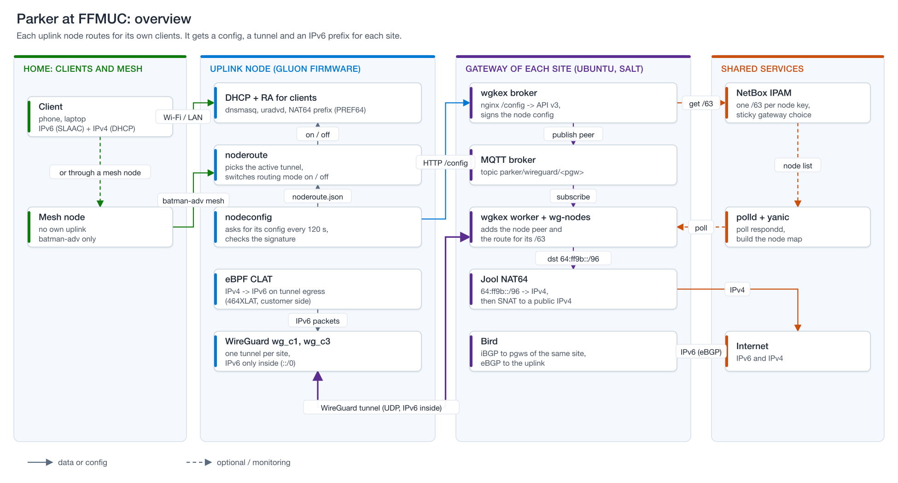
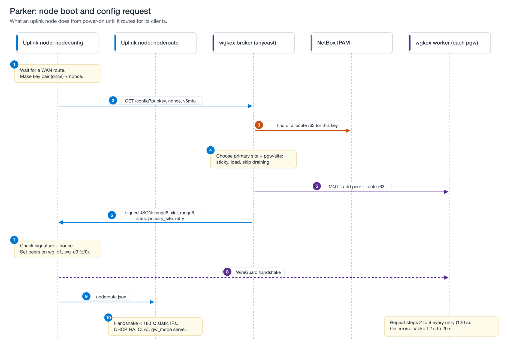
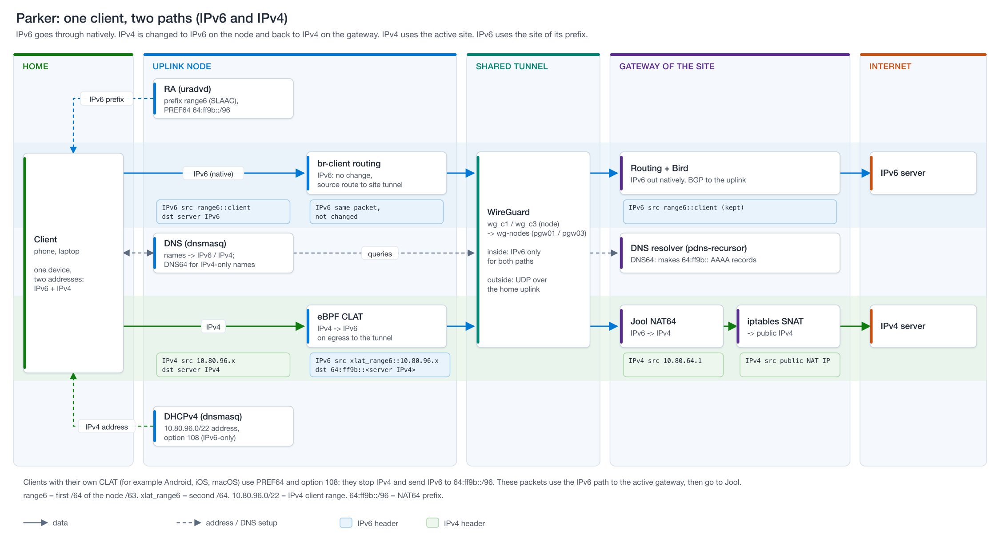
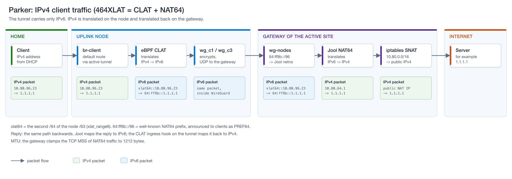
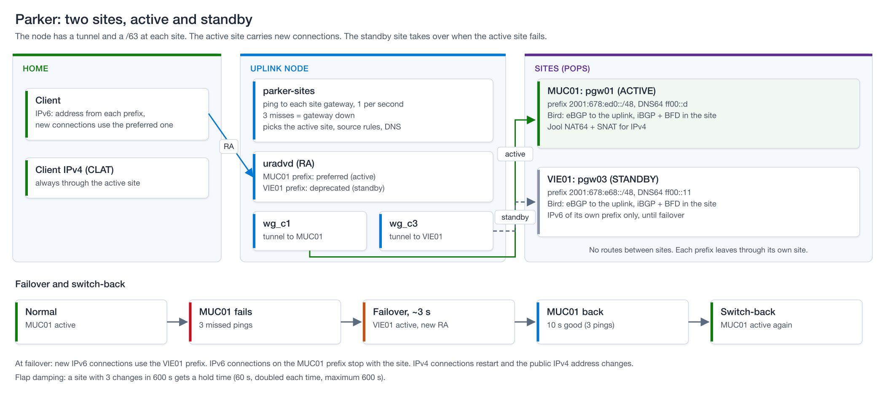

<section data-lang="de" class="language-content active" markdown="1">

**Kurz gesagt:** Wir testen eine neue Technik für unser Freifunk-Netz: **Parker**. Sie kommt von Freifunk Braunschweig. Die Firmware ist **sehr experimentell**. Wir suchen jetzt **Tester**: für einzelne Knoten **und für ganze Meshes**. Ein Mesh sind mehrere Knoten, die sich über WLAN oder Kabel verbinden.

> ⚠️ **Sehr experimentell.** Du kannst von der normalen FFMUC-Firmware auf Parker updaten. **Rechne aber damit, dass du zurück auf die normale Firmware musst.** Nimm keinen Knoten, auf den andere Menschen angewiesen sind.

- **Firmware:** [firmware.ffmuc.net/parker/](https://firmware.ffmuc.net/parker/) (Version `v2026.11.0-parker2`)
- **Test-Kanal im Chat:** [Projekt Parker - L3-routed APs](https://chat.ffmuc.net/freifunk/channels/projekt---l3-routed-aps)
- **Fehler melden:** als Issue in [freifunkMUC/site-ffm](https://github.com/freifunkMUC/site-ffm/issues) oder im Test-Kanal [Projekt Parker - L3-routed APs](https://chat.ffmuc.net/freifunk/channels/projekt---l3-routed-aps)
- **Karte der Test-Knoten:** [map-parker.ffmuc.net](https://map-parker.ffmuc.net/). Alle Parker-Knoten erscheinen auch auf der normalen Karte [map.ffmuc.net](https://map.ffmuc.net/).

## Was ist Parker?

Heute bilden alle Knoten zusammen **ein großes gemeinsames Netz**. Das ist wie ein riesiger Raum, in dem jedes Gerät das Hintergrundgemurmel aller anderen Geräte hört. Je mehr Knoten dazukommen, desto lauter wird es.

Mit Parker bekommt **jeder Knoten seinen eigenen kleinen Raum**: ein eigenes Netz mit eigenen IPv6-Adressen. Der Knoten ist ein kleiner Router. Er schickt nur den Verkehr seiner eigenen Clients durch einen verschlüsselten Tunnel zu unseren Servern. Das Gemurmel der anderen hört er nicht mehr.

**Das bringt dir:** weniger Hintergrundverkehr, ein stabileres Netz, und das Netz kann weiter wachsen. Dein Mesh vor Ort bleibt, wie es ist.

## Was ändert sich für dich?

- **Eigenes IPv6-Präfix für jeden Knoten.** Es gibt kein gemeinsames Layer-2-Netz mehr und keinen Broadcast-Verkehr von anderen Orten.
- **IPv4 geht weiter**, wird aber unterwegs über IPv6 transportiert (464XLAT).
- **Der Knoten wählt selbst den Standort**: München oder Wien. Fällt einer aus, schaltet der Knoten in etwa 3 Sekunden um.
- **Ein WLAN-Name für alle**: Heute braucht jede Domäne einen eigenen WLAN-Namen (z. B. `muenchen.freifunk.net/augsburg`), damit die großen gemeinsamen Netze getrennt bleiben. Mit Parker ist das nicht mehr nötig: Alle Parker-Knoten senden überall `muenchen.freifunk.net`. Die Hardware bleibt gleich.

## Warum IPv6?

IPv6 ist die Zukunft des Internets. IPv4 brauchen wir nur noch für Dienste, die noch kein IPv6 anbieten.

Darum setzt Parker ganz auf IPv6. Jeder Knoten bekommt eigene IPv6-Adressen. IPv4 funktioniert weiter: Parker übersetzt es unterwegs in IPv6. Moderne Handys und Laptops nutzen von selbst nur IPv6. Ältere Geräte bekommen weiter IPv4.

## So testest du

1. **Notiere** Name, Standort und Kontakt deines Knotens.
2. Hol dir die Firmware im Firmware-Selector auf [firmware.ffmuc.net](https://firmware.ffmuc.net/):
   - **Schritt 1:** Gib dein Routermodell ein. Prüfe Modell **und Hardware-Revision**.
   - **Schritt 2:** Wähle **Upgrade** (Sysupgrade-Image).
   - **Schritt 3:** Klicke auf **Experimentelle Firmware anzeigen**, lies die Warnung und wähle **parker**.

   Alternativ findest du alle Images direkt unter [firmware.ffmuc.net/parker/](https://firmware.ffmuc.net/parker/).
3. Spiele es wie gewohnt ein: im **Konfigurationsmodus** über „Firmware aktualisieren“ oder per SSH mit `sysupgrade`.
4. Prüfe, ob dein Knoten auf der [Parker-Karte](https://map-parker.ffmuc.net/) erscheint.
5. Sag uns im Test-Kanal [Projekt Parker - L3-routed APs](https://chat.ffmuc.net/freifunk/channels/projekt---l3-routed-aps), was geht und was nicht.

**Du hast ein Mesh?** Wir wollen Parker auch mit Meshes testen. Probier Parker in deinem Mesh aus und erzähl uns im Test-Kanal [Projekt Parker - L3-routed APs](https://chat.ffmuc.net/freifunk/channels/projekt---l3-routed-aps), wie es läuft. Parker-Knoten sind in einer eigenen Domäne. Sie meshen nur mit anderen Parker-Knoten, darum aktualisiere alle Knoten in deinem Mesh.

## Zurück zur normalen Firmware

1. Lade das normale FFMUC-Image (**stable**) für dein Modell von [firmware.ffmuc.net](https://firmware.ffmuc.net/).
2. Starte den Knoten im **Konfigurationsmodus** (Reset-Taste beim Start gedrückt halten) oder melde dich per SSH an.
3. Spiele das normale Image ein. Klappt der Start danach nicht sauber: **Einstellungen nicht übernehmen** (`sysupgrade -n`) und den Knoten neu einrichten.

Hilfe bekommst du jederzeit im Test-Kanal [Projekt Parker - L3-routed APs](https://chat.ffmuc.net/freifunk/channels/projekt---l3-routed-aps).

## Wie es dazu kam

Im April 2021 haben wir in [site-ffm#87](https://github.com/freifunkMUC/site-ffm/issues/87) die Idee eines gerouteten FFMUC beschrieben: batman-adv nur noch im lokalen Mesh. Kurz danach meldete sich **Chris Fiege** ([@SmithChart](https://github.com/SmithChart)) von **Freifunk Braunschweig (FFBS)**: FFBS baut genau so etwas schon, unter dem Namen [Parker](https://freifunk-bs.de/parker.html). Seit Ende 2021 läuft Braunschweig damit. Mehr dazu im FFBS-Blog: [Project Parker (2018)](https://stratum0.org/blog/posts/2018/12/22/freifunk-parker/) und [Project Parker im Beta-Betrieb (2020)](https://stratum0.org/blog/posts/2020/01/12/freifunk-parker/).

Es folgte eine lange und gute Diskussion über Roaming, Datenschutz und feste IPv6-Präfixe, auch mit Leuten aus anderen Communities. Am **19./20. Oktober 2024** haben wir uns mit FFBS persönlich getroffen ([Notizen](https://pad.stratum0.org/p/freifunk_20240717_parker)). Heute läuft Parker auch bei uns als Test, mit zwei Standorten und IPv4 über IPv6. Dieses Wochenende (**21./22. November 2026**) treffen wir Freifunk Aachen in **Aachen**. Unsere Pakete sind upstream im Review: [community-packages#198 bis #203](https://github.com/freifunk-gluon/community-packages/pull/198).

## Danke!

Parker ist ein Gemeinschaftswerk über Community-Grenzen hinweg. **Danke an Freifunk Braunschweig** für Parker selbst. Danke an **Freifunk Aachen**, besonders an **Florian Maurer** ([@maurerle](https://github.com/maurerle)), für Code und dafür, dass sie uns dieses Wochenende einladen. Danke an **Jan Lübbe** ([@jluebbe](https://github.com/jluebbe)), **Grische** ([@grische](https://github.com/grische)), **Linus Lüssing** ([@T-X](https://github.com/T-X)) und [@lemoer](https://github.com/lemoer) für Code, Reviews und kluge Fragen. Und danke an **Tom Herbers** ([@herbetom](https://github.com/herbetom)), **Tobias** ([@T0biii](https://github.com/T0biii)) und [@goligo](https://github.com/goligo) für die Diskussion in [site-ffm#87](https://github.com/freifunkMUC/site-ffm/issues/87).

---

## Deep Dive für Nerds

Alle Details stehen in **[How Parker works](https://gist.github.com/awlx/4f3f2d867d8fd89abddf7959240e0e8c)**. Hier die Kurzfassung.

### Überblick

- Jeder Knoten mit Uplink ist ein Router für seine Clients. **batman-adv bleibt im lokalen Mesh**, nichts davon geht durch den Tunnel.
- Der **WireGuard-Tunnel trägt nur IPv6**.
- Die **Gateways** sprechen Bird: **iBGP + BFD** innerhalb eines Standorts, **eBGP** zum Uplink. Kein OSPF.

### Start und Konfiguration

Der Knoten fragt den Konfigurationsdienst (wgkex-Broker, `broker.ffmuc.net`, Anycast). Er bekommt eine **signierte Konfiguration**: einen WireGuard-Tunnel und ein **öffentliches IPv6-/63 pro Standort**. Das erste /64 ist für Clients (SLAAC), das zweite /64 für CLAT. Die Präfixe verwaltet NetBox.

### Ein Client, zwei Wege

- **IPv6** geht unverändert durch den Tunnel zum Gateway des Standorts, dem das Quell-Präfix gehört.
- **IPv4** nutzt **464XLAT**: Eine **eBPF-CLAT** auf dem Knoten übersetzt IPv4 in IPv6. **Jool (NAT64)** auf dem Gateway übersetzt zurück, danach SNAT.
- **DNS64** gibt es pro Standort.

### Warum IPv6-mostly?

- **Adressraum:** Jeder Knoten bekommt aus NetBox ein öffentliches **/63 pro Standort**. Routing pro Knoten statt eines großen Layer-2-Netzes geht nur, weil IPv6 genug Adressen hat. IPv4 braucht sowieso NAT.
- **IPv6-mostly ([RFC 8925](https://www.rfc-editor.org/rfc/rfc8925)):** Der Knoten sendet DHCPv4-**Option 108** und kündigt das NAT64-Präfix `64:ff9b::/96` per **PREF64 ([RFC 8781](https://www.rfc-editor.org/rfc/rfc8781))** im RA an. Moderne Geräte (iOS, macOS, Android, neuere Windows-Versionen) schalten IPv4 dann selbst ab. Die wenigen reinen IPv4-Ziele übersetzt ihr eigenes CLAT auf dem Gerät.
- **Ältere Geräte** bekommen weiter IPv4 per DHCP. Das CLAT auf dem Knoten übersetzt es.
- **Ergebnis:** Der meiste Verkehr ist natives IPv6 von Ende zu Ende, ohne NAT und ohne IPv4-Zustand für diese Clients. Wir brauchen weniger knappe IPv4-Adressen. IPv4 ist nur noch eine Übersetzung für Dienste ohne IPv6. Das Design ist einfacher und zukunftssicher.
- **Grenze:** Bei einem Standortwechsel starten IPv4-Verbindungen neu, und die öffentliche IPv4-Adresse ändert sich. IPv6 läuft weiter.

### Zwei Standorte: Active/Standby

| | MUC01 | VIE01 |
|---|---|---|
| Gateway | pgw01 | pgw03 |
| Präfixe aus | `2001:678:ed0::/48` | `2001:678:e68::/48` |

- Der Daemon **`parker-sites`** pingt das Gateway jedes Standorts **einmal pro Sekunde**. **3 Ausfälle = down**, Umschalten nach etwa **3 s**. Zurück erst nach **10 s** ohne Fehler. **Flap-Dämpfung 60 s bis 600 s**.
- Das RA hält das aktive Präfix „preferred“ und setzt das Standby-Präfix auf „deprecated“.
- **Source Routing:** Jedes Präfix verlässt das Netz über seinen eigenen Standort. Zwischen den Standorten gibt es keine Routen.
- **Bewusster Kompromiss:** Beim Umschalten starten IPv4-Verbindungen neu, und die öffentliche IPv4 ändert sich. IPv6 hat Vorrang.

### Upstream

Die Parker-Pakete sind im Review bei Gluon: [freifunk-gluon/community-packages#198 bis #203](https://github.com/freifunk-gluon/community-packages/pull/198) (Multi-Site, 464XLAT, eBPF-CLAT, respondd, RA-Filter und Migration).

</section>

<section data-lang="en" class="language-content" markdown="1">

## Parker is here (experimental): we need testers for nodes and meshes

**In short:** We test a new technology for our Freifunk network: **Parker**. It comes from Freifunk Braunschweig. The firmware is **very experimental**. We need **testers** now: for single nodes **and for full meshes**. A mesh is a group of nodes that connect through Wi-Fi or cable.

> ⚠️ **Very experimental.** You can upgrade from the normal FFMUC firmware to Parker. **But be ready to go back to the normal firmware.** Do not use a node that other people depend on.

- **Firmware:** [firmware.ffmuc.net/parker/](https://firmware.ffmuc.net/parker/) (version `v2026.11.0-parker2`)
- **Test channel in our chat:** [Projekt Parker - L3-routed APs](https://chat.ffmuc.net/freifunk/channels/projekt---l3-routed-aps)
- **Report bugs:** as an issue in [freifunkMUC/site-ffm](https://github.com/freifunkMUC/site-ffm/issues) or in the test channel [Projekt Parker - L3-routed APs](https://chat.ffmuc.net/freifunk/channels/projekt---l3-routed-aps)
- **Map of the test nodes:** [map-parker.ffmuc.net](https://map-parker.ffmuc.net/). All Parker nodes also show on the main map [map.ffmuc.net](https://map.ffmuc.net/).

## What is Parker?

Today, all nodes make **one large shared network**. This is like one very large room: each device hears the background noise of all other devices. When more nodes join, the noise increases.

With Parker, **each node gets its own small room**: its own network with its own IPv6 addresses. The node is a small router. It sends only the traffic of its own clients through an encrypted tunnel to our servers. It does not hear the noise of the other nodes.

**What you get:** less background traffic, a more stable network, and the network can become larger. Your local mesh does not change.

## What changes for you?

- **Each node gets its own IPv6 prefix.** There is no shared layer-2 network and no broadcast traffic from other places.
- **IPv4 continues to work.** It goes through IPv6 on the way (464XLAT).
- **The node selects the site itself**: Munich or Vienna. If one site fails, the node changes to the other site in approximately 3 seconds.
- **One Wi-Fi name for all**: Today, each domain needs its own Wi-Fi name (for example `muenchen.freifunk.net/augsburg`) to keep the large shared networks separate. With Parker, this is not necessary. All Parker nodes send `muenchen.freifunk.net` everywhere. The hardware stays the same.

## Why IPv6?

IPv6 is the future of the internet. We need IPv4 only for services that do not have IPv6 yet.

Thus, Parker uses IPv6 for all traffic. Each node gets its own IPv6 addresses. IPv4 continues to work: Parker translates it to IPv6 on the way. Modern phones and laptops automatically use only IPv6. Older devices still get IPv4.

## How to test

1. **Write down** the name, the location and the contact of your node.
2. Get the firmware from the firmware selector at [firmware.ffmuc.net](https://firmware.ffmuc.net/). The selector is in German:
   - **Step 1 ("Wähle Dein Routermodell"):** Type your router model. Check the model **and the hardware revision**.
   - **Step 2 ("Wähle Deine Installationsart"):** Select **Upgrade** (sysupgrade image).
   - **Step 3 ("Wähle Deinen Update-Kanal"):** Click **Experimentelle Firmware anzeigen** ("show experimental firmware"). Read the warning. Then select **parker**.

   You can also find all images directly at [firmware.ffmuc.net/parker/](https://firmware.ffmuc.net/parker/).
3. Install it as usual: in **config mode** with "Upgrade firmware", or with `sysupgrade` through SSH.
4. Make sure that your node shows on the [Parker map](https://map-parker.ffmuc.net/).
5. Tell us in the test channel [Projekt Parker - L3-routed APs](https://chat.ffmuc.net/freifunk/channels/projekt---l3-routed-aps) what works and what does not work.

**Do you have a mesh?** We also want to test Parker with meshes. Try Parker in your mesh and tell us in the test channel [Projekt Parker - L3-routed APs](https://chat.ffmuc.net/freifunk/channels/projekt---l3-routed-aps) how it works. Parker nodes are in their own domain. They mesh only with other Parker nodes, so update all nodes in your mesh.

## Go back to the normal firmware

1. Download the normal FFMUC image (**stable**) for your model from [firmware.ffmuc.net](https://firmware.ffmuc.net/).
2. Start the node in **config mode** (push and hold the reset button during start), or connect through SSH.
3. Install the normal image. If the node does not start correctly: **do not keep the settings** (`sysupgrade -n`) and set up the node again.

You can get help at any time in the test channel [Projekt Parker - L3-routed APs](https://chat.ffmuc.net/freifunk/channels/projekt---l3-routed-aps).

## History

In April 2021, we described the idea of a routed FFMUC in [site-ffm#87](https://github.com/freifunkMUC/site-ffm/issues/87): batman-adv only in the local mesh. Soon after, **Chris Fiege** ([@SmithChart](https://github.com/SmithChart)) from **Freifunk Braunschweig (FFBS)** replied: FFBS already built this, with the name [Parker](https://freifunk-bs.de/parker.html). Braunschweig uses it since the end of 2021. Read more in the FFBS blog (German): [Project Parker (2018)](https://stratum0.org/blog/posts/2018/12/22/freifunk-parker/) and [Project Parker in beta (2020)](https://stratum0.org/blog/posts/2020/01/12/freifunk-parker/).

A long and good discussion followed about roaming, privacy and fixed IPv6 prefixes, also with people from other communities. On **19/20 October 2024** we met FFBS in person ([notes](https://pad.stratum0.org/p/freifunk_20240717_parker)). Now Parker also runs at FFMUC as a test, with two sites and IPv4 through IPv6. This weekend (**21/22 November 2026**), we meet Freifunk Aachen in **Aachen**. Our packages are in upstream review: [community-packages#198 to #203](https://github.com/freifunk-gluon/community-packages/pull/198).

## Thank you!

Parker is a joint work of many communities. **Thank you, Freifunk Braunschweig**, for Parker. Thank you, **Freifunk Aachen**, and especially **Florian Maurer** ([@maurerle](https://github.com/maurerle)), for code and for hosting us this weekend. Thank you to **Jan Lübbe** ([@jluebbe](https://github.com/jluebbe)), **Grische** ([@grische](https://github.com/grische)), **Linus Lüssing** ([@T-X](https://github.com/T-X)) and [@lemoer](https://github.com/lemoer) for code, reviews and good questions. And thank you to **Tom Herbers** ([@herbetom](https://github.com/herbetom)), **Tobias** ([@T0biii](https://github.com/T0biii)) and [@goligo](https://github.com/goligo) for the discussion in [site-ffm#87](https://github.com/freifunkMUC/site-ffm/issues/87).

---

## Deep dive for nerds

All details are in **[How Parker works](https://gist.github.com/awlx/4f3f2d867d8fd89abddf7959240e0e8c)**. This is the short version.

### Overview

- Each node with an uplink is a router for its clients. **batman-adv stays in the local mesh.** It does not go through the tunnel.
- The **WireGuard tunnel carries only IPv6**.
- The **gateways** use Bird: **iBGP + BFD** in a site, **eBGP** to the uplink. No OSPF.

### Start and configuration

The node asks the config service (wgkex broker, `broker.ffmuc.net`, anycast). It gets a **signed configuration**: one WireGuard tunnel and one **public IPv6 /63 for each site**. The first /64 is for clients (SLAAC). The second /64 is for CLAT. NetBox stores the prefixes.

### One client, two paths

- **IPv6** goes through the tunnel without change. It goes to the gateway of the site that owns the source prefix.
- **IPv4** uses **464XLAT**: an **eBPF CLAT** on the node translates IPv4 to IPv6. **Jool (NAT64)** on the gateway translates it back. Then SNAT occurs.
- Each site has its own **DNS64**.

### Why IPv6-mostly?

- **Address space:** each node gets a public **/63 for each site** from NetBox. Routing for each node, instead of one large layer-2 network, is possible only because IPv6 has sufficient addresses. IPv4 needs NAT in all cases.
- **IPv6-mostly ([RFC 8925](https://www.rfc-editor.org/rfc/rfc8925)):** the node sends DHCPv4 **option 108**. It announces the NAT64 prefix `64:ff9b::/96` with **PREF64 ([RFC 8781](https://www.rfc-editor.org/rfc/rfc8781))** in the RA. Modern devices (iOS, macOS, Android, newer Windows) then stop IPv4 themselves and use only IPv6. Their own CLAT on the device translates the few IPv4-only destinations.
- **Older devices** still get IPv4 through DHCP. The CLAT on the node translates it.
- **Result:** most traffic is native IPv6 from end to end, with no NAT and no IPv4 state for these clients. We need fewer scarce IPv4 addresses. IPv4 is only a translation for services without IPv6. The design is simpler and ready for the future.
- **Limit:** at a site failover, IPv4 connections start again and the public IPv4 address changes. IPv6 continues.

### Two sites: active/standby

| | MUC01 | VIE01 |
|---|---|---|
| Gateway | pgw01 | pgw03 |
| Prefixes from | `2001:678:ed0::/48` | `2001:678:e68::/48` |

- The **`parker-sites`** daemon pings the gateway of each site **one time each second**. **3 misses = down.** Failover occurs in approximately **3 s**. Switch-back occurs only after **10 s** without errors. **Flap damping: 60 s to 600 s.**
- The RA keeps the active prefix "preferred". It sets the standby prefix to "deprecated".
- **Source routing:** each prefix goes out through its own site. There are no routes between the sites.
- **Known trade-off:** at a failover, IPv4 connections start again and the public IPv4 address changes. IPv6 has priority.

### Upstream

The Parker packages are in review at Gluon: [freifunk-gluon/community-packages#198 to #203](https://github.com/freifunk-gluon/community-packages/pull/198) (multi-site, 464XLAT, eBPF CLAT, respondd, RA filter and migration).

</section>

<section data-lang="fr" class="language-content" markdown="1">

## Parker est là (expérimental) : nous cherchons des testeurs pour nœuds et meshes

**En bref :** Nous testons une nouvelle technique pour notre réseau Freifunk : **Parker**. Elle vient de Freifunk Braunschweig. Le firmware est **très expérimental**. Nous cherchons maintenant des **testeurs** : pour des nœuds seuls **et pour des meshes entiers**. Un mesh, ce sont plusieurs nœuds reliés par Wi-Fi ou par câble.

> ⚠️ **Très expérimental.** Vous pouvez passer du firmware FFMUC normal à Parker. **Mais soyez prêt à revenir au firmware normal.** N'utilisez pas un nœud dont d'autres personnes dépendent.

- **Firmware :** [firmware.ffmuc.net/parker/](https://firmware.ffmuc.net/parker/) (version `v2026.11.0-parker2`)
- **Canal de test dans le chat :** [Projekt Parker - L3-routed APs](https://chat.ffmuc.net/freifunk/channels/projekt---l3-routed-aps)
- **Signaler un bug :** comme issue dans [freifunkMUC/site-ffm](https://github.com/freifunkMUC/site-ffm/issues) ou dans le canal de test [Projekt Parker - L3-routed APs](https://chat.ffmuc.net/freifunk/channels/projekt---l3-routed-aps)
- **Carte des nœuds de test :** [map-parker.ffmuc.net](https://map-parker.ffmuc.net/). Tous les nœuds Parker apparaissent aussi sur la carte principale [map.ffmuc.net](https://map.ffmuc.net/).

## Qu'est-ce que Parker ?

Aujourd'hui, tous les nœuds forment **un seul grand réseau commun**. C'est comme une immense salle où chaque appareil entend le bruit de fond de tous les autres. Plus il y a de nœuds, plus le bruit augmente.

Avec Parker, **chaque nœud a sa propre petite salle** : son propre réseau avec ses propres adresses IPv6. Le nœud est un petit routeur. Il envoie seulement le trafic de ses propres clients dans un tunnel chiffré vers nos serveurs. Il n'entend plus le bruit des autres.

**Ce que vous y gagnez :** moins de trafic de fond, un réseau plus stable, et un réseau qui peut grandir. Votre mesh local reste tel quel.

## Qu'est-ce qui change pour vous ?

- **Chaque nœud a son propre préfixe IPv6.** Il n'y a plus de réseau commun de couche 2 ni de trafic broadcast venant d'ailleurs.
- **L'IPv4 fonctionne toujours**, mais passe par IPv6 en chemin (464XLAT).
- **Le nœud choisit lui-même le site** : Munich ou Vienne. Si un site tombe, le nœud bascule en 3 secondes environ.
- **Un seul nom Wi-Fi pour tous** : aujourd'hui, chaque domaine a besoin de son propre nom Wi-Fi (par ex. `muenchen.freifunk.net/augsburg`) pour garder les grands réseaux communs séparés. Avec Parker, ce n'est plus nécessaire : tous les nœuds Parker diffusent `muenchen.freifunk.net` partout. Le matériel reste le même.

## Pourquoi IPv6 ?

IPv6 est l'avenir d'Internet. Nous avons besoin d'IPv4 seulement pour les services qui n'offrent pas encore IPv6.

C'est pourquoi Parker utilise IPv6 pour tout le trafic. Chaque nœud reçoit ses propres adresses IPv6. IPv4 continue de fonctionner : Parker le traduit en IPv6 en chemin. Les téléphones et portables modernes utilisent automatiquement seulement IPv6. Les appareils plus anciens reçoivent toujours IPv4.

## Comment tester

1. **Notez** le nom, l'emplacement et le contact de votre nœud.
2. Téléchargez le firmware avec le sélecteur sur [firmware.ffmuc.net](https://firmware.ffmuc.net/) (en allemand) :
   - **Étape 1 (« Wähle Dein Routermodell ») :** saisissez le modèle de votre routeur. Vérifiez le modèle **et la révision matérielle**.
   - **Étape 2 (« Wähle Deine Installationsart ») :** choisissez **Upgrade** (image sysupgrade).
   - **Étape 3 (« Wähle Deinen Update-Kanal ») :** cliquez sur **Experimentelle Firmware anzeigen** (« afficher le firmware expérimental »), lisez l'avertissement, puis choisissez **parker**.

   Vous trouvez aussi toutes les images directement sur [firmware.ffmuc.net/parker/](https://firmware.ffmuc.net/parker/).
3. Installez-la comme d'habitude : en **mode configuration** avec « Mettre à jour le firmware », ou avec `sysupgrade` via SSH.
4. Vérifiez que votre nœud apparaît sur la [carte Parker](https://map-parker.ffmuc.net/).
5. Dites-nous dans le canal de test [Projekt Parker - L3-routed APs](https://chat.ffmuc.net/freifunk/channels/projekt---l3-routed-aps) ce qui marche et ce qui ne marche pas.

**Vous avez un mesh ?** Nous voulons aussi tester Parker avec des meshes. Essayez Parker dans votre mesh et dites-nous dans le canal de test [Projekt Parker - L3-routed APs](https://chat.ffmuc.net/freifunk/channels/projekt---l3-routed-aps) comment cela fonctionne. Les nœuds Parker sont dans leur propre domaine. Ils ne forment un mesh qu'avec d'autres nœuds Parker : mettez donc à jour tous les nœuds de votre mesh.

## Revenir au firmware normal

1. Téléchargez l'image FFMUC normale (**stable**) pour votre modèle sur [firmware.ffmuc.net](https://firmware.ffmuc.net/).
2. Démarrez le nœud en **mode configuration** (maintenez le bouton reset pendant le démarrage) ou connectez-vous via SSH.
3. Installez l'image normale. Si le nœud ne démarre pas correctement : **ne gardez pas les réglages** (`sysupgrade -n`) et configurez le nœud à nouveau.

Vous trouverez de l'aide à tout moment dans le canal de test [Projekt Parker - L3-routed APs](https://chat.ffmuc.net/freifunk/channels/projekt---l3-routed-aps).

## L'histoire

En avril 2021, nous avons décrit l'idée d'un FFMUC routé dans [site-ffm#87](https://github.com/freifunkMUC/site-ffm/issues/87) : batman-adv seulement dans le mesh local. Peu après, **Chris Fiege** ([@SmithChart](https://github.com/SmithChart)) de **Freifunk Braunschweig (FFBS)** a répondu : FFBS construisait déjà exactement cela, sous le nom [Parker](https://freifunk-bs.de/parker.html). Braunschweig l'utilise depuis fin 2021. Pour en savoir plus, voir le blog de FFBS (en allemand) : [Project Parker (2018)](https://stratum0.org/blog/posts/2018/12/22/freifunk-parker/) et [Project Parker en bêta (2020)](https://stratum0.org/blog/posts/2020/01/12/freifunk-parker/).

Une longue et bonne discussion a suivi sur le roaming, la vie privée et les préfixes IPv6 fixes, aussi avec des personnes d'autres communautés. Les **19 et 20 octobre 2024**, nous avons rencontré FFBS en personne ([notes](https://pad.stratum0.org/p/freifunk_20240717_parker)). Aujourd'hui, Parker tourne aussi chez nous en test, avec deux sites et l'IPv4 via IPv6. Ce week-end (**21 et 22 novembre 2026**), nous rencontrons Freifunk Aachen à **Aix-la-Chapelle**. Nos paquets sont en revue upstream : [community-packages#198 à #203](https://github.com/freifunk-gluon/community-packages/pull/198).

## Merci !

Parker est un travail commun entre plusieurs communautés. **Merci à Freifunk Braunschweig** pour Parker. Merci à **Freifunk Aachen**, et en particulier à **Florian Maurer** ([@maurerle](https://github.com/maurerle)), pour le code et pour nous accueillir ce week-end. Merci à **Jan Lübbe** ([@jluebbe](https://github.com/jluebbe)), **Grische** ([@grische](https://github.com/grische)), **Linus Lüssing** ([@T-X](https://github.com/T-X)) et [@lemoer](https://github.com/lemoer) pour le code, les revues et les bonnes questions. Et merci à **Tom Herbers** ([@herbetom](https://github.com/herbetom)), **Tobias** ([@T0biii](https://github.com/T0biii)) et [@goligo](https://github.com/goligo) pour la discussion dans [site-ffm#87](https://github.com/freifunkMUC/site-ffm/issues/87).

---

## Plongée technique

Tous les détails sont dans **[How Parker works](https://gist.github.com/awlx/4f3f2d867d8fd89abddf7959240e0e8c)** (en anglais). Voici le résumé.

### Vue d'ensemble

- Chaque nœud avec uplink est un routeur pour ses clients. **batman-adv reste dans le mesh local** et ne passe pas par le tunnel.
- Le **tunnel WireGuard ne transporte que de l'IPv6**.
- Les **passerelles** utilisent Bird : **iBGP + BFD** dans un site, **eBGP** vers l'uplink. Pas d'OSPF.

### Démarrage et configuration

Le nœud interroge le service de configuration (broker wgkex, `broker.ffmuc.net`, anycast). Il reçoit une **configuration signée** : un tunnel WireGuard et un **/63 IPv6 public par site**. Le premier /64 sert aux clients (SLAAC), le second au CLAT. NetBox gère les préfixes.

### Un client, deux chemins

- L'**IPv6** traverse le tunnel sans modification, vers la passerelle du site qui possède le préfixe source.
- L'**IPv4** utilise **464XLAT** : un **CLAT eBPF** sur le nœud traduit IPv4 en IPv6. **Jool (NAT64)** sur la passerelle retraduit, puis SNAT.
- Chaque site a son propre **DNS64**.

### Pourquoi IPv6-mostly ?

- **Espace d'adresses :** chaque nœud reçoit de NetBox un **/63 public par site**. Le routage par nœud, au lieu d'un grand réseau de couche 2, n'est possible que parce qu'IPv6 a assez d'adresses. IPv4 a besoin de NAT dans tous les cas.
- **IPv6-mostly ([RFC 8925](https://www.rfc-editor.org/rfc/rfc8925)) :** le nœud envoie l'**option 108** DHCPv4 et annonce le préfixe NAT64 `64:ff9b::/96` avec **PREF64 ([RFC 8781](https://www.rfc-editor.org/rfc/rfc8781))** dans le RA. Les appareils modernes (iOS, macOS, Android, Windows récent) désactivent alors IPv4 eux-mêmes. Leur propre CLAT traduit sur l'appareil les rares destinations IPv4 seulement.
- **Les appareils plus anciens** reçoivent toujours IPv4 par DHCP. Le CLAT du nœud le traduit.
- **Résultat :** la plupart du trafic est en IPv6 natif de bout en bout, sans NAT et sans état IPv4 pour ces clients. Nous avons besoin de moins d'adresses IPv4 rares. IPv4 n'est plus qu'une traduction pour les services sans IPv6. Le design est plus simple et prêt pour l'avenir.
- **Limite :** lors d'un basculement de site, les connexions IPv4 redémarrent et l'adresse IPv4 publique change. IPv6 continue.

### Deux sites : actif/veille

| | MUC01 | VIE01 |
|---|---|---|
| Passerelle | pgw01 | pgw03 |
| Préfixes de | `2001:678:ed0::/48` | `2001:678:e68::/48` |

- Le démon **`parker-sites`** envoie un ping à la passerelle de chaque site **une fois par seconde**. **3 pertes = hors service.** Bascule en **3 s** environ. Retour seulement après **10 s** sans erreur. **Amortissement des oscillations : 60 s à 600 s.**
- Le RA garde le préfixe actif « preferred » et passe le préfixe de veille en « deprecated ».
- **Routage par source :** chaque préfixe sort par son propre site. Il n'y a pas de routes entre les sites.
- **Compromis assumé :** lors d'une bascule, les connexions IPv4 redémarrent et l'adresse IPv4 publique change. L'IPv6 a la priorité.

### Upstream

Les paquets Parker sont en revue chez Gluon : [freifunk-gluon/community-packages#198 à #203](https://github.com/freifunk-gluon/community-packages/pull/198) (multi-site, 464XLAT, CLAT eBPF, respondd, filtre RA et migration).

</section>

<section data-lang="es" class="language-content" markdown="1">

## Parker ya está aquí (experimental): buscamos testers para nodos y meshes

**En resumen:** Probamos una nueva técnica para nuestra red Freifunk: **Parker**. Viene de Freifunk Braunschweig. El firmware es **muy experimental**. Ahora buscamos **testers**: para nodos sueltos **y para meshes completos**. Un mesh son varios nodos conectados por Wi-Fi o por cable.

> ⚠️ **Muy experimental.** Puedes actualizar del firmware normal de FFMUC a Parker. **Pero prepárate para volver al firmware normal.** No uses un nodo del que dependan otras personas.

- **Firmware:** [firmware.ffmuc.net/parker/](https://firmware.ffmuc.net/parker/) (versión `v2026.11.0-parker2`)
- **Canal de pruebas en el chat:** [Projekt Parker - L3-routed APs](https://chat.ffmuc.net/freifunk/channels/projekt---l3-routed-aps)
- **Informar de errores:** como issue en [freifunkMUC/site-ffm](https://github.com/freifunkMUC/site-ffm/issues) o en el canal de pruebas [Projekt Parker - L3-routed APs](https://chat.ffmuc.net/freifunk/channels/projekt---l3-routed-aps)
- **Mapa de los nodos de prueba:** [map-parker.ffmuc.net](https://map-parker.ffmuc.net/). Todos los nodos Parker aparecen también en el mapa principal [map.ffmuc.net](https://map.ffmuc.net/).

## ¿Qué es Parker?

Hoy todos los nodos forman **una sola red grande y compartida**. Es como una sala enorme donde cada dispositivo oye el murmullo de fondo de todos los demás. Cuantos más nodos hay, más ruido.

Con Parker, **cada nodo tiene su propia sala pequeña**: su propia red con sus propias direcciones IPv6. El nodo es un pequeño router. Envía solo el tráfico de sus propios clientes por un túnel cifrado a nuestros servidores. Ya no oye el murmullo de los demás.

**Lo que ganas:** menos tráfico de fondo, una red más estable y una red que puede crecer más. Tu mesh local no cambia.

## ¿Qué cambia para ti?

- **Cada nodo tiene su propio prefijo IPv6.** Ya no hay una red compartida de capa 2 ni tráfico broadcast de otros lugares.
- **IPv4 sigue funcionando**, pero viaja por IPv6 en el camino (464XLAT).
- **El nodo elige el sitio por sí mismo**: Múnich o Viena. Si uno falla, el nodo cambia al otro en unos 3 segundos.
- **Un solo nombre de Wi-Fi para todos**: hoy cada dominio necesita su propio nombre de Wi-Fi (p. ej. `muenchen.freifunk.net/augsburg`) para mantener separadas las grandes redes compartidas. Con Parker ya no hace falta: todos los nodos Parker emiten `muenchen.freifunk.net` en todas partes. El hardware es el mismo.

## ¿Por qué IPv6?

IPv6 es el futuro de internet. Solo necesitamos IPv4 para los servicios que todavía no ofrecen IPv6.

Por eso Parker usa IPv6 para todo el tráfico. Cada nodo recibe sus propias direcciones IPv6. IPv4 sigue funcionando: Parker lo traduce a IPv6 por el camino. Los móviles y portátiles modernos usan automáticamente solo IPv6. Los dispositivos más antiguos siguen recibiendo IPv4.

## Cómo probar

1. **Anota** el nombre, la ubicación y el contacto de tu nodo.
2. Descarga el firmware con el selector en [firmware.ffmuc.net](https://firmware.ffmuc.net/) (en alemán):
   - **Paso 1 («Wähle Dein Routermodell»):** escribe el modelo de tu router. Comprueba el modelo **y la revisión de hardware**.
   - **Paso 2 («Wähle Deine Installationsart»):** elige **Upgrade** (imagen sysupgrade).
   - **Paso 3 («Wähle Deinen Update-Kanal»):** haz clic en **Experimentelle Firmware anzeigen** («mostrar firmware experimental»), lee el aviso y elige **parker**.

   También encuentras todas las imágenes directamente en [firmware.ffmuc.net/parker/](https://firmware.ffmuc.net/parker/).
3. Instálala como siempre: en el **modo de configuración** con «Actualizar firmware», o con `sysupgrade` por SSH.
4. Comprueba que tu nodo aparece en el [mapa de Parker](https://map-parker.ffmuc.net/).
5. Cuéntanos en el canal de pruebas [Projekt Parker - L3-routed APs](https://chat.ffmuc.net/freifunk/channels/projekt---l3-routed-aps) qué funciona y qué no.

**¿Tienes un mesh?** También queremos probar Parker con meshes. Prueba Parker en tu mesh y cuéntanos en el canal de pruebas [Projekt Parker - L3-routed APs](https://chat.ffmuc.net/freifunk/channels/projekt---l3-routed-aps) cómo funciona. Los nodos Parker están en su propio dominio. Solo forman mesh con otros nodos Parker, así que actualiza todos los nodos de tu mesh.

## Volver al firmware normal

1. Descarga la imagen normal de FFMUC (**stable**) para tu modelo de [firmware.ffmuc.net](https://firmware.ffmuc.net/).
2. Arranca el nodo en **modo de configuración** (mantén pulsado el botón reset al arrancar) o conéctate por SSH.
3. Instala la imagen normal. Si el nodo no arranca bien: **no conserves los ajustes** (`sysupgrade -n`) y configura el nodo de nuevo.

Puedes pedir ayuda en cualquier momento en el canal de pruebas [Projekt Parker - L3-routed APs](https://chat.ffmuc.net/freifunk/channels/projekt---l3-routed-aps).

## La historia

En abril de 2021 describimos la idea de un FFMUC enrutado en [site-ffm#87](https://github.com/freifunkMUC/site-ffm/issues/87): batman-adv solo en el mesh local. Poco después respondió **Chris Fiege** ([@SmithChart](https://github.com/SmithChart)) de **Freifunk Braunschweig (FFBS)**: FFBS ya estaba construyendo exactamente eso, con el nombre [Parker](https://freifunk-bs.de/parker.html). Braunschweig lo usa desde finales de 2021. Más información en el blog de FFBS (en alemán): [Project Parker (2018)](https://stratum0.org/blog/posts/2018/12/22/freifunk-parker/) y [Project Parker en beta (2020)](https://stratum0.org/blog/posts/2020/01/12/freifunk-parker/).

Siguió una larga y buena discusión sobre roaming, privacidad y prefijos IPv6 fijos, también con personas de otras comunidades. El **19 y 20 de octubre de 2024** nos reunimos en persona con FFBS ([notas](https://pad.stratum0.org/p/freifunk_20240717_parker)). Hoy Parker también funciona en FFMUC como prueba, con dos sitios e IPv4 a través de IPv6. Este fin de semana (**21 y 22 de noviembre de 2026**) nos reunimos con Freifunk Aachen en **Aquisgrán**. Nuestros paquetes están en revisión upstream: [community-packages#198 a #203](https://github.com/freifunk-gluon/community-packages/pull/198).

## ¡Gracias!

Parker es un trabajo conjunto entre varias comunidades. **Gracias a Freifunk Braunschweig** por Parker. Gracias a **Freifunk Aachen**, en especial a **Florian Maurer** ([@maurerle](https://github.com/maurerle)), por el código y por recibirnos este fin de semana. Gracias a **Jan Lübbe** ([@jluebbe](https://github.com/jluebbe)), **Grische** ([@grische](https://github.com/grische)), **Linus Lüssing** ([@T-X](https://github.com/T-X)) y [@lemoer](https://github.com/lemoer) por el código, las revisiones y las buenas preguntas. Y gracias a **Tom Herbers** ([@herbetom](https://github.com/herbetom)), **Tobias** ([@T0biii](https://github.com/T0biii)) y [@goligo](https://github.com/goligo) por la discusión en [site-ffm#87](https://github.com/freifunkMUC/site-ffm/issues/87).

---

## A fondo para nerds

Todos los detalles están en **[How Parker works](https://gist.github.com/awlx/4f3f2d867d8fd89abddf7959240e0e8c)** (en inglés). Aquí el resumen.

### Visión general

- Cada nodo con uplink es un router para sus clientes. **batman-adv se queda en el mesh local** y no pasa por el túnel.
- El **túnel WireGuard solo transporta IPv6**.
- Los **gateways** usan Bird: **iBGP + BFD** dentro de un sitio, **eBGP** hacia el uplink. Sin OSPF.

### Arranque y configuración

El nodo consulta el servicio de configuración (broker wgkex, `broker.ffmuc.net`, anycast). Recibe una **configuración firmada**: un túnel WireGuard y un **/63 IPv6 público por sitio**. El primer /64 es para los clientes (SLAAC), el segundo para CLAT. NetBox gestiona los prefijos.

### Un cliente, dos caminos

- **IPv6** pasa por el túnel sin cambios, hacia el gateway del sitio al que pertenece el prefijo de origen.
- **IPv4** usa **464XLAT**: un **CLAT eBPF** en el nodo traduce IPv4 a IPv6. **Jool (NAT64)** en el gateway lo traduce de vuelta y después hace SNAT.
- Cada sitio tiene su propio **DNS64**.

### ¿Por qué IPv6-mostly?

- **Espacio de direcciones:** cada nodo recibe de NetBox un **/63 público por sitio**. El enrutamiento por nodo, en lugar de una gran red de capa 2, solo es posible porque IPv6 tiene suficientes direcciones. IPv4 necesita NAT en todo caso.
- **IPv6-mostly ([RFC 8925](https://www.rfc-editor.org/rfc/rfc8925)):** el nodo envía la **opción 108** de DHCPv4 y anuncia el prefijo NAT64 `64:ff9b::/96` con **PREF64 ([RFC 8781](https://www.rfc-editor.org/rfc/rfc8781))** en el RA. Los dispositivos modernos (iOS, macOS, Android, Windows reciente) desactivan IPv4 por sí mismos. Su propio CLAT traduce en el dispositivo los pocos destinos solo IPv4.
- **Los dispositivos más antiguos** siguen recibiendo IPv4 por DHCP. El CLAT del nodo lo traduce.
- **Resultado:** la mayor parte del tráfico es IPv6 nativo de extremo a extremo, sin NAT y sin estado IPv4 para estos clientes. Necesitamos menos direcciones IPv4 escasas. IPv4 es solo una traducción para los servicios sin IPv6. El diseño es más simple y está preparado para el futuro.
- **Límite:** en un cambio de sitio, las conexiones IPv4 se reinician y la dirección IPv4 pública cambia. IPv6 continúa.

### Dos sitios: activo/reserva

| | MUC01 | VIE01 |
|---|---|---|
| Gateway | pgw01 | pgw03 |
| Prefijos de | `2001:678:ed0::/48` | `2001:678:e68::/48` |

- El daemon **`parker-sites`** hace ping al gateway de cada sitio **una vez por segundo**. **3 fallos = caído.** El cambio ocurre en unos **3 s**. Vuelve solo tras **10 s** sin errores. **Amortiguación de oscilaciones: 60 s a 600 s.**
- El RA mantiene el prefijo activo como «preferred» y marca el de reserva como «deprecated».
- **Enrutamiento por origen:** cada prefijo sale por su propio sitio. No hay rutas entre los sitios.
- **Compromiso aceptado:** en un cambio, las conexiones IPv4 se reinician y la IPv4 pública cambia. IPv6 tiene prioridad.

### Upstream

Los paquetes de Parker están en revisión en Gluon: [freifunk-gluon/community-packages#198 a #203](https://github.com/freifunk-gluon/community-packages/pull/198) (multi-sitio, 464XLAT, CLAT eBPF, respondd, filtro RA y migración).

</section>

<section data-lang="ua" class="language-content" markdown="1">

## Parker вже тут (експериментально): шукаємо тестувальників для вузлів і mesh-мереж

**Коротко:** Ми тестуємо нову технологію для нашої мережі Freifunk: **Parker**. Вона походить від Freifunk Braunschweig. Прошивка **дуже експериментальна**. Зараз ми шукаємо **тестувальників**: для окремих вузлів **і для цілих mesh-мереж**. Mesh — це кілька вузлів, з'єднаних через Wi-Fi або кабель.

> ⚠️ **Дуже експериментально.** Ви можете оновитися зі звичайної прошивки FFMUC до Parker. **Але будьте готові повернутися до звичайної прошивки.** Не використовуйте вузол, від якого залежать інші люди.

- **Прошивка:** [firmware.ffmuc.net/parker/](https://firmware.ffmuc.net/parker/) (версія `v2026.11.0-parker2`)
- **Тестовий канал у чаті:** [Projekt Parker - L3-routed APs](https://chat.ffmuc.net/freifunk/channels/projekt---l3-routed-aps)
- **Повідомити про помилку:** як issue в [freifunkMUC/site-ffm](https://github.com/freifunkMUC/site-ffm/issues) або в тестовому каналі [Projekt Parker - L3-routed APs](https://chat.ffmuc.net/freifunk/channels/projekt---l3-routed-aps)
- **Карта тестових вузлів:** [map-parker.ffmuc.net](https://map-parker.ffmuc.net/). Усі вузли Parker також видно на основній карті [map.ffmuc.net](https://map.ffmuc.net/).

## Що таке Parker?

Сьогодні всі вузли разом утворюють **одну велику спільну мережу**. Це як величезна кімната, де кожен пристрій чує фоновий гомін усіх інших. Чим більше вузлів, тим голосніше.

З Parker **кожен вузол отримує власну маленьку кімнату**: свою мережу з власними IPv6-адресами. Вузол — це маленький роутер. Він надсилає лише трафік своїх клієнтів через зашифрований тунель до наших серверів. Гомону інших він більше не чує.

**Що це дає вам:** менше фонового трафіку, стабільніша мережа, і мережа може рости далі. Ваш локальний mesh не змінюється.

## Що зміниться для вас?

- **Кожен вузол має власний IPv6-префікс.** Немає спільної мережі рівня 2 і broadcast-трафіку з інших місць.
- **IPv4 працює далі**, але по дорозі передається через IPv6 (464XLAT).
- **Вузол сам обирає майданчик**: Мюнхен або Відень. Якщо один не працює, вузол перемикається приблизно за 3 секунди.
- **Одна назва Wi-Fi для всіх**: зараз кожен домен потребує власної назви Wi-Fi (наприклад, `muenchen.freifunk.net/augsburg`), щоб великі спільні мережі залишалися окремими. З Parker це більше не потрібно: усі вузли Parker всюди транслюють `muenchen.freifunk.net`. Обладнання те саме.

## Чому IPv6?

IPv6 — це майбутнє інтернету. IPv4 потрібен нам лише для сервісів, які ще не мають IPv6.

Тому Parker використовує IPv6 для всього трафіку. Кожен вузол отримує власні IPv6-адреси. IPv4 і далі працює: Parker дорогою транслює його в IPv6. Сучасні телефони й ноутбуки автоматично використовують лише IPv6. Старіші пристрої й далі отримують IPv4.

## Як тестувати

1. **Запишіть** назву, місце та контакт вашого вузла.
2. Завантажте прошивку через селектор на [firmware.ffmuc.net](https://firmware.ffmuc.net/) (німецькою):
   - **Крок 1 («Wähle Dein Routermodell»):** введіть модель роутера. Перевірте модель **і апаратну ревізію**.
   - **Крок 2 («Wähle Deine Installationsart»):** виберіть **Upgrade** (sysupgrade-образ).
   - **Крок 3 («Wähle Deinen Update-Kanal»):** натисніть **Experimentelle Firmware anzeigen** («показати експериментальну прошивку»), прочитайте попередження й виберіть **parker**.

   Усі образи також є напряму на [firmware.ffmuc.net/parker/](https://firmware.ffmuc.net/parker/).
3. Встановіть його як завжди: у **режимі налаштування** через «Оновити прошивку» або командою `sysupgrade` через SSH.
4. Перевірте, що ваш вузол з'явився на [карті Parker](https://map-parker.ffmuc.net/).
5. Розкажіть нам у тестовому каналі [Projekt Parker - L3-routed APs](https://chat.ffmuc.net/freifunk/channels/projekt---l3-routed-aps), що працює, а що ні.

**У вас є mesh?** Ми також хочемо тестувати Parker з mesh-мережами. Спробуйте Parker у своїй mesh-мережі й розкажіть нам у тестовому каналі [Projekt Parker - L3-routed APs](https://chat.ffmuc.net/freifunk/channels/projekt---l3-routed-aps), як усе працює. Вузли Parker мають власний домен. Вони утворюють mesh лише з іншими вузлами Parker, тому оновіть усі вузли у своїй mesh-мережі.

## Повернення до звичайної прошивки

1. Завантажте звичайний образ FFMUC (**stable**) для вашої моделі з [firmware.ffmuc.net](https://firmware.ffmuc.net/).
2. Запустіть вузол у **режимі налаштування** (утримуйте кнопку reset під час запуску) або підключіться через SSH.
3. Встановіть звичайний образ. Якщо вузол не запускається правильно: **не зберігайте налаштування** (`sysupgrade -n`) і налаштуйте вузол заново.

Допомогу можна отримати будь-коли в тестовому каналі [Projekt Parker - L3-routed APs](https://chat.ffmuc.net/freifunk/channels/projekt---l3-routed-aps).

## Історія

У квітні 2021 року ми описали ідею маршрутизованої мережі FFMUC у [site-ffm#87](https://github.com/freifunkMUC/site-ffm/issues/87): batman-adv лише в локальному mesh. Невдовзі відповів **Chris Fiege** ([@SmithChart](https://github.com/SmithChart)) з **Freifunk Braunschweig (FFBS)**: FFBS вже будував саме це під назвою [Parker](https://freifunk-bs.de/parker.html). Брауншвейг використовує його з кінця 2021 року. Більше в блозі FFBS (німецькою): [Project Parker (2018)](https://stratum0.org/blog/posts/2018/12/22/freifunk-parker/) і [Project Parker у бета-режимі (2020)](https://stratum0.org/blog/posts/2020/01/12/freifunk-parker/).

Далі була довга й корисна дискусія про роумінг, приватність і фіксовані IPv6-префікси, також з людьми з інших спільнот. **19–20 жовтня 2024 року** ми особисто зустрілися з FFBS ([нотатки](https://pad.stratum0.org/p/freifunk_20240717_parker)). Тепер Parker працює і в нас як тест, з двома майданчиками та IPv4 через IPv6. Цими вихідними (**21–22 листопада 2026 року**) ми зустрічаємося з Freifunk Aachen в **Ахені**. Наші пакети на рев'ю upstream: [community-packages#198–#203](https://github.com/freifunk-gluon/community-packages/pull/198).

## Дякуємо!

Parker — спільна робота багатьох спільнот. **Дякуємо Freifunk Braunschweig** за Parker. Дякуємо **Freifunk Aachen**, особливо **Florian Maurer** ([@maurerle](https://github.com/maurerle)), за код і за те, що приймають нас цими вихідними. Дякуємо **Jan Lübbe** ([@jluebbe](https://github.com/jluebbe)), **Grische** ([@grische](https://github.com/grische)), **Linus Lüssing** ([@T-X](https://github.com/T-X)) і [@lemoer](https://github.com/lemoer) за код, рев'ю та слушні питання. А також дякуємо **Tom Herbers** ([@herbetom](https://github.com/herbetom)), **Tobias** ([@T0biii](https://github.com/T0biii)) і [@goligo](https://github.com/goligo) за дискусію в [site-ffm#87](https://github.com/freifunkMUC/site-ffm/issues/87).

---

## Технічні подробиці

Усі деталі — у **[How Parker works](https://gist.github.com/awlx/4f3f2d867d8fd89abddf7959240e0e8c)** (англійською). Тут коротка версія.

### Огляд

- Кожен вузол з аплінком — роутер для своїх клієнтів. **batman-adv залишається в локальному mesh** і не йде через тунель.
- **Тунель WireGuard передає лише IPv6**.
- **Шлюзи** використовують Bird: **iBGP + BFD** всередині майданчика, **eBGP** до аплінку. Без OSPF.

### Запуск і конфігурація

Вузол звертається до сервісу конфігурації (брокер wgkex, `broker.ffmuc.net`, anycast). Він отримує **підписану конфігурацію**: один тунель WireGuard і **публічний IPv6 /63 для кожного майданчика**. Перший /64 — для клієнтів (SLAAC), другий — для CLAT. Префікси зберігаються в NetBox.

### Один клієнт, два шляхи

- **IPv6** проходить через тунель без змін до шлюзу майданчика, якому належить префікс джерела.
- **IPv4** використовує **464XLAT**: **eBPF CLAT** на вузлі перекладає IPv4 в IPv6. **Jool (NAT64)** на шлюзі перекладає назад, потім SNAT.
- Кожен майданчик має свій **DNS64**.

### Чому IPv6-mostly?

- **Адресний простір:** кожен вузол отримує з NetBox публічний **/63 для кожного майданчика**. Маршрутизація для кожного вузла замість однієї великої мережі рівня 2 можлива лише тому, що IPv6 має достатньо адрес. IPv4 у будь-якому разі потребує NAT.
- **IPv6-mostly ([RFC 8925](https://www.rfc-editor.org/rfc/rfc8925)):** вузол надсилає DHCPv4 **опцію 108** і оголошує NAT64-префікс `64:ff9b::/96` через **PREF64 ([RFC 8781](https://www.rfc-editor.org/rfc/rfc8781))** в RA. Сучасні пристрої (iOS, macOS, Android, новіші Windows) тоді самі вимикають IPv4. Їхній власний CLAT на пристрої транслює небагато адрес, доступних лише через IPv4.
- **Старіші пристрої** й далі отримують IPv4 через DHCP. CLAT на вузлі транслює його.
- **Результат:** більшість трафіку — нативний IPv6 від кінця до кінця, без NAT і без IPv4-стану для цих клієнтів. Потрібно менше дефіцитних IPv4-адрес. IPv4 — лише трансляція для сервісів без IPv6. Дизайн простіший і готовий до майбутнього.
- **Обмеження:** під час перемикання майданчика IPv4-з'єднання починаються заново, а публічна IPv4-адреса змінюється. IPv6 працює далі.

### Два майданчики: активний/резервний

| | MUC01 | VIE01 |
|---|---|---|
| Шлюз | pgw01 | pgw03 |
| Префікси з | `2001:678:ed0::/48` | `2001:678:e68::/48` |

- Демон **`parker-sites`** пінгує шлюз кожного майданчика **раз на секунду**. **3 пропуски = недоступний.** Перемикання приблизно за **3 с**. Повернення лише після **10 с** без помилок. **Гасіння коливань: від 60 с до 600 с.**
- RA тримає активний префікс як «preferred», а резервний позначає як «deprecated».
- **Маршрутизація за джерелом:** кожен префікс виходить через свій майданчик. Маршрутів між майданчиками немає.
- **Свідомий компроміс:** під час перемикання з'єднання IPv4 перезапускаються, а публічна IPv4-адреса змінюється. Пріоритет має IPv6.

### Upstream

Пакети Parker на рев'ю в Gluon: [freifunk-gluon/community-packages#198–#203](https://github.com/freifunk-gluon/community-packages/pull/198) (мультисайт, 464XLAT, eBPF CLAT, respondd, RA-фільтр і міграція).

</section>
