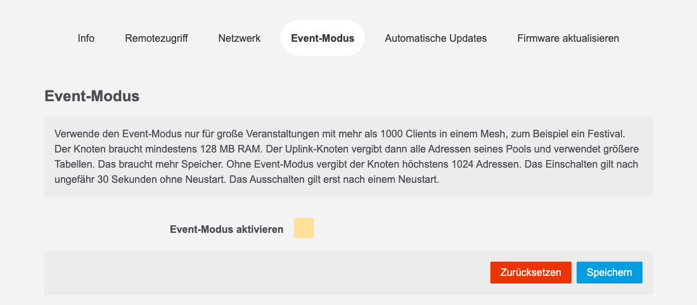
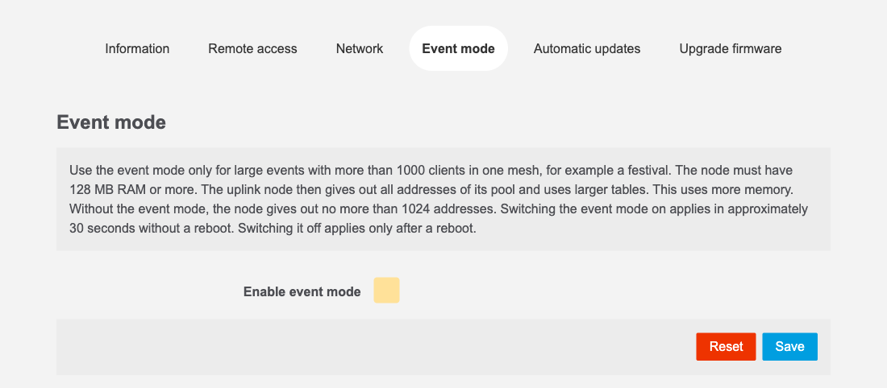

<section data-lang="de" class="language-content active" markdown="1">

**Kurz gesagt:** Seit heute Morgen ist **Parker v2026.11.1-parker8** auf dem Branch `parker` verfügbar. Knoten auf diesem Branch aktualisieren sich automatisch. Am Wochenende haben wir Fehler behoben und große Tests im Labor gemacht. **Wir haben ein gutes Gefühl, dass Parker bald stable wird.** Dafür brauchen wir **jetzt mehr Tester**.

Frühere Beiträge: [Parker: experimentelle Tests]() und [Parker wird stabiler]().

- **Test-Kanal im Chat:** [Projekt Parker - L3-routed APs](https://chat.ffmuc.net/freifunk/channels/projekt---l3-routed-aps)
- **Fehler melden:** als Issue in [freifunkMUC/site-ffm](https://github.com/freifunkMUC/site-ffm/issues) oder im Test-Kanal
- **Offene Punkte:** [site-ffm#1011](https://github.com/freifunkMUC/site-ffm/issues/1011)
- **Karte der Parker-Knoten:** [map-parker.ffmuc.net](https://map-parker.ffmuc.net/)

## Was Parker jetzt kann

- **Zwei Standorte: München und Wien.** Fällt ein Standort aus, schaltet der Knoten automatisch auf den anderen um und später wieder zurück.
- **DNS64 an jedem Standort** und **IPv4 über IPv6** mit einer CLAT auf dem Knoten. Alte Geräte, die nur IPv4 können, funktionieren weiter.
- **Verschlüsseltes WLAN (OWE):** eine zusätzliche SSID `<ssid>/encrypted` neben der offenen SSID. Sie ist immer an.
- **Bis zu 1021 Clients pro Knoten** als Standard: 1021 DHCP-Adressen (ein /22 ohne Netz-, Broadcast- und Router-Adresse), Nachbartabelle 4096 Einträge, Verbindungstabelle (Conntrack) 16384 Einträge.
- **Neuer Event-Modus für große Veranstaltungen.** Du schaltest ihn im Konfigurationsmodus ein. Der Client-Bereich wächst von /22 auf /20: **4093 DHCP-Adressen** statt 1021. Die Tabellen hängen vom RAM ab:
  - **256 MB RAM oder mehr:** Nachbartabelle 16384, Conntrack 65536, DNS-Cache 4096 Einträge.
  - **128 MB RAM:** Nachbartabelle 8192, Conntrack 32768, DNS-Cache 2048 Einträge.
  - **Unter 128 MB RAM:** kein Event-Modus.

  Das Einschalten wirkt nach etwa 30 Sekunden ohne Neustart. Das Ausschalten wirkt erst nach einem Neustart.

  

- **Robusteres Routing:** Die IPv6-Standardroute zeigt jetzt auf die Link-Local-Adresse des Gateways.
- **Weniger Gateway-Wechsel:** Der Server hält den Knoten auf seinem Gateway. Der Knoten legt das Gateway nicht mehr selbst fest.
- **Weniger Last:** Der Knoten lädt seine Konfiguration nicht mehr alle 2 Minuten neu, wenn sich nichts geändert hat.
- **CLAT jetzt auch auf PowerPC-Routern** (mpc85xx, apm821xx). Ein Test auf echter Hardware fehlt noch.

## Was am Wochenende passiert ist

- **parker7 ist erschienen.** Alle Parker-Knoten haben sich ohne Probleme aktualisiert.
- **Danach wechselten Knoten oft zwischen den zwei Gateways in Wien.** Grund: Der Server wählte das Gateway nach Last. Beide Gateways hatten fast die gleiche Last, darum änderte sich die Wahl bei jeder Abfrage. Clients sahen kurze Unterbrechungen. Wir haben das noch am Wochenende auf der Server-Seite behoben. Der Server hält jetzt jeden Knoten auf seinem Gateway. Ein Firmware-Update war dafür nicht nötig.
- **Große Tests im Labor:** Etwa **4000 Clients auf einem Knoten** über 16 Minuten, kein Client ging verloren. Dazu ein Hochlauf auf 1200 Clients mit Event-Modus. Die Ergebnisse sind in parker8 eingeflossen.
- **parker8** haben wir im Labor und auf einem Testknoten geprüft. Am 23. November haben wir es veröffentlicht.

## Kurs auf Stable: Wir suchen Tester

Wir haben ein gutes Gefühl, dass Parker bald die stabile Firmware wird. Vorher wollen wir es auf mehr Knoten und Meshes sehen. Besonders gesucht:

- **große Installationen** mit vielen Clients
- **Events**, gern mit Event-Modus
- Knoten mit **LTE- oder Mobilfunk-Uplink**
- Besitzer von **PowerPC-Routern** (mpc85xx, apm821xx)

**Gut zu wissen:** Bis jetzt wollte kein Tester zurück zur alten Firmware. Probier es aus!

> ⚠️ **Noch keine stabile Firmware.** Parker ist noch im Test. Prüfe vor dem Update **Modell und Hardware-Revision** deines Routers.

## So testest du Parker

1. Öffne den Firmware-Selector auf [firmware.ffmuc.net](https://firmware.ffmuc.net/) und gib dein Routermodell ein. Prüfe Modell **und Hardware-Revision**.
2. Klicke auf **Experimentelle Firmware anzeigen**, lies die Warnung und wähle **parker**.
3. Spiele das Image wie gewohnt ein: im Konfigurationsmodus oder per SSH mit `sysupgrade`.

**Mesh:** Parker-Knoten meshen nur mit anderen Parker-Knoten. Alle Knoten in einem Mesh müssen Parker nutzen.

**Zurück zu stable:** Das geht jederzeit. Spiele das normale FFMUC-Image (**stable**) von [firmware.ffmuc.net](https://firmware.ffmuc.net/) ein. Die Schritte stehen im [ersten Beitrag]().

## Danke

**Danke an Lukas Stockner** für die Korrektur des eBPF-JIT auf PowerPC. Damit läuft die CLAT jetzt auch auf diesen Routern. **Danke an alle Tester und Knotenbetreiber.** Ihr macht Parker besser!

</section>

<section data-lang="en" class="language-content" markdown="1">

## Parker after the weekend: many new features, heading to stable

**In short:** Since this morning, **Parker v2026.11.1-parker8** is available on the `parker` branch. Nodes on this branch update automatically. Over the weekend we fixed bugs and ran large tests in the lab. **We have a good feeling that Parker moves to stable soon.** For this, we **need more testers now**.

Earlier posts: [Parker: experimental tests]() and [Parker is getting more stable]().

- **Test channel in the chat:** [Projekt Parker - L3-routed APs](https://chat.ffmuc.net/freifunk/channels/projekt---l3-routed-aps)
- **Report bugs:** as an issue in [freifunkMUC/site-ffm](https://github.com/freifunkMUC/site-ffm/issues) or in the test channel
- **Open items:** [site-ffm#1011](https://github.com/freifunkMUC/site-ffm/issues/1011)
- **Map of Parker nodes:** [map-parker.ffmuc.net](https://map-parker.ffmuc.net/)

## What Parker does now

- **Two sites: Munich and Vienna.** If one site fails, the node switches to the other site automatically, and later switches back.
- **DNS64 at each site** and **IPv4 over IPv6** with a CLAT on the node. Old devices that can use only IPv4 continue to work.
- **Encrypted Wi-Fi (OWE):** an additional SSID `<ssid>/encrypted` next to the open SSID. It is always on.
- **Up to 1021 clients per node** by default: 1021 DHCP addresses (a /22 without the network, broadcast and router address), neighbour table 4096 entries, connection tracking (conntrack) 16384 entries.
- **New event mode for large events.** You turn it on in config mode. The client network grows from /22 to /20: **4093 DHCP addresses** instead of 1021. The tables depend on the RAM:
  - **256 MB RAM or more:** neighbour table 16384, conntrack 65536, DNS cache 4096 entries.
  - **128 MB RAM:** neighbour table 8192, conntrack 32768, DNS cache 2048 entries.
  - **Less than 128 MB RAM:** no event mode.

  Turning it on takes effect after approximately 30 seconds, without a reboot. Turning it off takes effect only after a reboot.

  

- **More robust routing:** The IPv6 default route now points to the link-local address of the gateway.
- **Fewer gateway changes:** The server keeps the node on its gateway. The node no longer sets the gateway itself.
- **Less load:** The node no longer reloads its configuration every 2 minutes when nothing changed.
- **CLAT now also on PowerPC routers** (mpc85xx, apm821xx). A test on real hardware is still open.

## What happened over the weekend

- **We released parker7.** All Parker nodes updated without problems.
- **After that, nodes often switched between the two gateways in Vienna.** Cause: The server selected the gateway by load. Both gateways had almost the same load, so the selection changed at each query. Clients saw short interruptions. We fixed this on the server side during the same weekend. The server now keeps each node on its gateway. This fix did not need a firmware update.
- **Large tests in the lab:** About **4000 clients on one node** for 16 minutes, with no lost clients. Also a ramp-up to 1200 clients with event mode. The results went into parker8.
- We tested **parker8** in the lab and on a test node. We released it on 23 November.

## Heading to stable: we need testers

We have a good feeling that Parker becomes the stable firmware soon. Before that, we want to see it on more nodes and meshes. We especially want:

- **large installations** with many clients
- **events**, with event mode if possible
- nodes with an **LTE or cellular uplink**
- owners of **PowerPC routers** (mpc85xx, apm821xx)

**Good to know:** Until now, no tester wanted to go back to the old firmware. Try it!

> ⚠️ **Not a stable firmware yet.** Parker is still in test. Before the update, check the **model and hardware revision** of your router.

## How to test Parker

1. Open the firmware selector on [firmware.ffmuc.net](https://firmware.ffmuc.net/) and enter your router model. Check the model **and the hardware revision**.
2. Click **Show experimental firmware**, read the warning and select **parker**.
3. Install the image as usual: in config mode, or through SSH with `sysupgrade`.

**Mesh:** Parker nodes mesh only with other Parker nodes. All nodes in a mesh must use Parker.

**Back to stable:** You can do this at any time. Install the normal FFMUC image (**stable**) from [firmware.ffmuc.net](https://firmware.ffmuc.net/). The steps are in the [first post]().

## Thank you

**Thank you to Lukas Stockner** for the fix of the eBPF JIT on PowerPC. With it, the CLAT now also works on these routers. **Thank you to all testers and node owners.** You make Parker better!

</section>

<section data-lang="fr" class="language-content" markdown="1">

## Parker après le week-end : beaucoup de nouvelles fonctions, cap sur stable

**En bref :** Depuis ce matin, **Parker v2026.11.1-parker8** est disponible sur la branche `parker`. Les nœuds sur cette branche se mettent à jour automatiquement. Ce week-end, nous avons corrigé des bugs et fait de grands tests en laboratoire. **Nous avons un bon pressentiment : Parker passera bientôt en stable.** Pour cela, nous **cherchons maintenant plus de testeurs**.

Articles précédents : [Parker : tests expérimentaux]() et [Parker devient plus stable]().

- **Canal de test dans le chat :** [Projekt Parker - L3-routed APs](https://chat.ffmuc.net/freifunk/channels/projekt---l3-routed-aps)
- **Signaler un bug :** comme issue dans [freifunkMUC/site-ffm](https://github.com/freifunkMUC/site-ffm/issues) ou dans le canal de test
- **Points ouverts :** [site-ffm#1011](https://github.com/freifunkMUC/site-ffm/issues/1011)
- **Carte des nœuds Parker :** [map-parker.ffmuc.net](https://map-parker.ffmuc.net/)

## Ce que Parker fait maintenant

- **Deux sites : Munich et Vienne.** Si un site tombe en panne, le nœud passe automatiquement à l'autre, puis revient plus tard.
- **DNS64 sur chaque site** et **IPv4 sur IPv6** avec un CLAT sur le nœud. Les anciens appareils qui ne savent utiliser que l'IPv4 continuent de fonctionner.
- **Wi-Fi chiffré (OWE) :** un SSID supplémentaire `<ssid>/encrypted` à côté du SSID ouvert. Il est toujours actif.
- **Jusqu'à 1021 clients par nœud** par défaut : 1021 adresses DHCP (un /22 sans les adresses de réseau, de broadcast et du routeur), table des voisins 4096 entrées, suivi des connexions (conntrack) 16384 entrées.
- **Nouveau mode événement pour les grands événements.** Vous l'activez en mode configuration. Le réseau des clients passe de /22 à /20 : **4093 adresses DHCP** au lieu de 1021. Les tables dépendent de la RAM :
  - **256 Mo de RAM ou plus :** table des voisins 16384, conntrack 65536, cache DNS 4096 entrées.
  - **128 Mo de RAM :** table des voisins 8192, conntrack 32768, cache DNS 2048 entrées.
  - **Moins de 128 Mo de RAM :** pas de mode événement.

  L'activation agit après environ 30 secondes, sans redémarrage. La désactivation agit seulement après un redémarrage.

  

- **Routage plus robuste :** La route IPv6 par défaut pointe maintenant vers l'adresse link-local de la passerelle.
- **Moins de changements de passerelle :** Le serveur garde le nœud sur sa passerelle. Le nœud ne fixe plus la passerelle lui-même.
- **Moins de charge :** Le nœud ne recharge plus sa configuration toutes les 2 minutes si rien n'a changé.
- **CLAT aussi sur les routeurs PowerPC** (mpc85xx, apm821xx). Un test sur du vrai matériel reste à faire.

## Ce qui s'est passé ce week-end

- **Nous avons publié parker7.** Tous les nœuds Parker se sont mis à jour sans problème.
- **Ensuite, des nœuds changeaient souvent entre les deux passerelles de Vienne.** Cause : le serveur choisissait la passerelle selon la charge. Les deux passerelles avaient presque la même charge, donc le choix changeait à chaque requête. Les clients voyaient de courtes coupures. Nous l'avons corrigé côté serveur le même week-end. Le serveur garde maintenant chaque nœud sur sa passerelle. Cette correction n'a pas demandé de mise à jour du firmware.
- **Grands tests en laboratoire :** Environ **4000 clients sur un nœud** pendant 16 minutes, sans perte de client. Aussi une montée à 1200 clients avec le mode événement. Les résultats sont entrés dans parker8.
- Nous avons testé **parker8** en laboratoire et sur un nœud de test. Nous l'avons publié le 23 novembre.

## Cap sur stable : nous cherchons des testeurs

Nous avons un bon pressentiment : Parker deviendra bientôt le firmware stable. Avant, nous voulons le voir sur plus de nœuds et de meshes. Nous cherchons surtout :

- de **grandes installations** avec beaucoup de clients
- des **événements**, si possible avec le mode événement
- des nœuds avec une **liaison LTE ou mobile**
- des propriétaires de **routeurs PowerPC** (mpc85xx, apm821xx)

**Bon à savoir :** Jusqu'à présent, aucun testeur n'a voulu revenir à l'ancien firmware. Essayez !

> ⚠️ **Pas encore un firmware stable.** Parker est encore en test. Avant la mise à jour, vérifiez le **modèle et la révision matérielle** de votre routeur.

## Comment tester Parker

1. Ouvrez le sélecteur de firmware sur [firmware.ffmuc.net](https://firmware.ffmuc.net/) et entrez le modèle de votre routeur. Vérifiez le modèle **et la révision matérielle**.
2. Cliquez sur **Afficher le firmware expérimental**, lisez l'avertissement et choisissez **parker**.
3. Installez l'image comme d'habitude : en mode configuration, ou par SSH avec `sysupgrade`.

**Mesh :** Les nœuds Parker ne font du mesh qu'avec d'autres nœuds Parker. Tous les nœuds d'un mesh doivent utiliser Parker.

**Retour à stable :** C'est possible à tout moment. Installez l'image FFMUC normale (**stable**) depuis [firmware.ffmuc.net](https://firmware.ffmuc.net/). Les étapes sont dans le [premier article]().

## Merci

**Merci à Lukas Stockner** pour la correction du JIT eBPF sur PowerPC. Grâce à elle, le CLAT fonctionne aussi sur ces routeurs. **Merci à tous les testeurs et à toutes les personnes qui gèrent des nœuds.** Vous rendez Parker meilleur !

</section>

<section data-lang="es" class="language-content" markdown="1">

## Parker después del fin de semana: muchas funciones nuevas, rumbo a stable

**En resumen:** Desde esta mañana, **Parker v2026.11.1-parker8** está disponible en la rama `parker`. Los nodos en esta rama se actualizan automáticamente. Durante el fin de semana corregimos errores e hicimos grandes pruebas en el laboratorio. **Tenemos una buena sensación: Parker pasará pronto a stable.** Para eso **necesitamos ahora más testers**.

Artículos anteriores: [Parker: pruebas experimentales]() y [Parker es más estable]().

- **Canal de pruebas en el chat:** [Projekt Parker - L3-routed APs](https://chat.ffmuc.net/freifunk/channels/projekt---l3-routed-aps)
- **Informar de errores:** como issue en [freifunkMUC/site-ffm](https://github.com/freifunkMUC/site-ffm/issues) o en el canal de pruebas
- **Puntos abiertos:** [site-ffm#1011](https://github.com/freifunkMUC/site-ffm/issues/1011)
- **Mapa de nodos Parker:** [map-parker.ffmuc.net](https://map-parker.ffmuc.net/)

## Qué hace Parker ahora

- **Dos sitios: Múnich y Viena.** Si un sitio falla, el nodo cambia automáticamente al otro y después vuelve.
- **DNS64 en cada sitio** e **IPv4 sobre IPv6** con un CLAT en el nodo. Los dispositivos antiguos que solo usan IPv4 siguen funcionando.
- **Wi-Fi cifrado (OWE):** un SSID adicional `<ssid>/encrypted` junto al SSID abierto. Siempre está activo.
- **Hasta 1021 clientes por nodo** por defecto: 1021 direcciones DHCP (un /22 sin las direcciones de red, broadcast y router), tabla de vecinos 4096 entradas, seguimiento de conexiones (conntrack) 16384 entradas.
- **Nuevo modo evento para eventos grandes.** Lo activas en el modo de configuración. La red de clientes crece de /22 a /20: **4093 direcciones DHCP** en lugar de 1021. Las tablas dependen de la RAM:
  - **256 MB de RAM o más:** tabla de vecinos 16384, conntrack 65536, caché DNS 4096 entradas.
  - **128 MB de RAM:** tabla de vecinos 8192, conntrack 32768, caché DNS 2048 entradas.
  - **Menos de 128 MB de RAM:** no hay modo evento.

  Activarlo tiene efecto tras unos 30 segundos, sin reiniciar. Desactivarlo tiene efecto solo después de reiniciar.

  

- **Enrutamiento más robusto:** La ruta IPv6 por defecto apunta ahora a la dirección link-local del gateway.
- **Menos cambios de gateway:** El servidor mantiene el nodo en su gateway. El nodo ya no fija el gateway por sí mismo.
- **Menos carga:** El nodo ya no recarga su configuración cada 2 minutos si nada cambió.
- **CLAT también en routers PowerPC** (mpc85xx, apm821xx). Falta todavía una prueba en hardware real.

## Qué pasó el fin de semana

- **Publicamos parker7.** Todos los nodos Parker se actualizaron sin problemas.
- **Después, algunos nodos cambiaban a menudo entre los dos gateways de Viena.** Causa: el servidor elegía el gateway según la carga. Los dos gateways tenían casi la misma carga, así que la elección cambiaba en cada consulta. Los clientes veían cortes breves. Lo corregimos en el lado del servidor el mismo fin de semana. El servidor mantiene ahora cada nodo en su gateway. Esta corrección no necesitó una actualización de firmware.
- **Grandes pruebas en el laboratorio:** Unos **4000 clientes en un nodo** durante 16 minutos, sin perder ningún cliente. También una subida a 1200 clientes con modo evento. Los resultados entraron en parker8.
- Probamos **parker8** en el laboratorio y en un nodo de prueba. Lo publicamos el 23 de noviembre.

## Rumbo a stable: buscamos testers

Tenemos una buena sensación: Parker será pronto el firmware estable. Antes queremos verlo en más nodos y meshes. Buscamos sobre todo:

- **instalaciones grandes** con muchos clientes
- **eventos**, a ser posible con modo evento
- nodos con **enlace LTE o móvil**
- propietarios de **routers PowerPC** (mpc85xx, apm821xx)

**Bueno saberlo:** Hasta ahora, ningún tester ha querido volver al firmware antiguo. ¡Pruébalo!

> ⚠️ **Aún no es un firmware estable.** Parker sigue en pruebas. Antes de actualizar, comprueba el **modelo y la revisión de hardware** de tu router.

## Cómo probar Parker

1. Abre el selector de firmware en [firmware.ffmuc.net](https://firmware.ffmuc.net/) y escribe el modelo de tu router. Comprueba el modelo **y la revisión de hardware**.
2. Haz clic en **Mostrar firmware experimental**, lee la advertencia y elige **parker**.
3. Instala la imagen como siempre: en el modo de configuración, o por SSH con `sysupgrade`.

**Mesh:** Los nodos Parker solo hacen mesh con otros nodos Parker. Todos los nodos de un mesh deben usar Parker.

**Volver a stable:** Puedes hacerlo en cualquier momento. Instala la imagen normal de FFMUC (**stable**) desde [firmware.ffmuc.net](https://firmware.ffmuc.net/). Los pasos están en el [primer artículo]().

## Gracias

**Gracias a Lukas Stockner** por la corrección del JIT eBPF en PowerPC. Con ella, el CLAT funciona ahora también en estos routers. **Gracias a todas las personas que prueban y que gestionan nodos.** ¡Hacéis Parker mejor!

</section>

<section data-lang="ua" class="language-content" markdown="1">

## Parker після вихідних: багато нових функцій, курс на stable

**Коротко:** З сьогоднішнього ранку **Parker v2026.11.1-parker8** доступний у гілці `parker`. Вузли в цій гілці оновлюються автоматично. На вихідних ми виправили помилки і провели великі тести в лабораторії. **У нас добре відчуття, що Parker скоро стане stable.** Для цього нам **зараз потрібно більше тестувальників**.

Попередні дописи: [Parker: експериментальні тести]() і [Parker стає стабільнішим]().

- **Тестовий канал у чаті:** [Projekt Parker - L3-routed APs](https://chat.ffmuc.net/freifunk/channels/projekt---l3-routed-aps)
- **Повідомити про помилку:** як issue в [freifunkMUC/site-ffm](https://github.com/freifunkMUC/site-ffm/issues) або в тестовому каналі
- **Відкриті питання:** [site-ffm#1011](https://github.com/freifunkMUC/site-ffm/issues/1011)
- **Карта вузлів Parker:** [map-parker.ffmuc.net](https://map-parker.ffmuc.net/)

## Що Parker уміє тепер

- **Два майданчики: Мюнхен і Відень.** Якщо один майданчик не працює, вузол автоматично перемикається на інший, а потім повертається назад.
- **DNS64 на кожному майданчику** і **IPv4 через IPv6** з CLAT на вузлі. Старі пристрої, які знають лише IPv4, працюють далі.
- **Зашифрований Wi-Fi (OWE):** додатковий SSID `<ssid>/encrypted` поруч із відкритим SSID. Він завжди увімкнений.
- **До 1021 клієнта на вузол** за замовчуванням: 1021 адреса DHCP (мережа /22 без адрес мережі, broadcast і роутера), таблиця сусідів 4096 записів, відстеження з'єднань (conntrack) 16384 записи.
- **Новий режим подій для великих заходів.** Ви вмикаєте його в режимі конфігурації. Мережа клієнтів зростає з /22 до /20: **4093 адреси DHCP** замість 1021. Таблиці залежать від RAM:
  - **256 МБ RAM або більше:** таблиця сусідів 16384, conntrack 65536, кеш DNS 4096 записів.
  - **128 МБ RAM:** таблиця сусідів 8192, conntrack 32768, кеш DNS 2048 записів.
  - **Менше 128 МБ RAM:** режиму подій немає.

  Увімкнення діє приблизно через 30 секунд, без перезавантаження. Вимкнення діє лише після перезавантаження.

  

- **Надійніша маршрутизація:** Маршрут IPv6 за замовчуванням тепер вказує на link-local адресу шлюзу.
- **Менше змін шлюзу:** Сервер тримає вузол на його шлюзі. Вузол більше не фіксує шлюз сам.
- **Менше навантаження:** Вузол більше не перезавантажує конфігурацію кожні 2 хвилини, якщо нічого не змінилося.
- **CLAT тепер і на роутерах PowerPC** (mpc85xx, apm821xx). Тест на справжньому обладнанні ще попереду.

## Що сталося на вихідних

- **Ми випустили parker7.** Усі вузли Parker оновилися без проблем.
- **Після цього вузли часто перемикалися між двома шлюзами у Відні.** Причина: сервер обирав шлюз за навантаженням. Обидва шлюзи мали майже однакове навантаження, тому вибір змінювався при кожному запиті. Клієнти бачили короткі перерви. Ми виправили це на стороні сервера ще на тих самих вихідних. Тепер сервер тримає кожен вузол на його шлюзі. Для цього не було потрібне оновлення прошивки.
- **Великі тести в лабораторії:** Приблизно **4000 клієнтів на одному вузлі** протягом 16 хвилин, без втрати клієнтів. Також поступове зростання до 1200 клієнтів у режимі подій. Результати увійшли в parker8.
- Ми перевірили **parker8** у лабораторії і на тестовому вузлі. Ми випустили його 23 листопада.

## Курс на stable: шукаємо тестувальників

У нас добре відчуття, що Parker скоро стане стабільною прошивкою. Перед цим ми хочемо побачити його на більшій кількості вузлів і mesh-мереж. Особливо шукаємо:

- **великі інсталяції** з багатьма клієнтами
- **заходи**, бажано з режимом подій
- вузли з **LTE або мобільним каналом**
- власників **роутерів PowerPC** (mpc85xx, apm821xx)

**Варто знати:** Досі жоден тестувальник не захотів повернутися до старої прошивки. Спробуйте!

> ⚠️ **Це ще не стабільна прошивка.** Parker ще в тестуванні. Перед оновленням перевірте **модель і апаратну ревізію** вашого роутера.

## Як тестувати Parker

1. Відкрийте Firmware-Selector на [firmware.ffmuc.net](https://firmware.ffmuc.net/) і введіть модель роутера. Перевірте модель **і апаратну ревізію**.
2. Натисніть **Показати експериментальну прошивку**, прочитайте попередження і виберіть **parker**.
3. Встановіть образ як зазвичай: у режимі конфігурації або через SSH командою `sysupgrade`.

**Mesh:** Вузли Parker утворюють mesh лише з іншими вузлами Parker. Усі вузли в mesh-мережі мають використовувати Parker.

**Назад до stable:** Це можна зробити будь-коли. Встановіть звичайний образ FFMUC (**stable**) з [firmware.ffmuc.net](https://firmware.ffmuc.net/). Кроки описано в [першому дописі]().

## Дякуємо

**Дякуємо Lukas Stockner** за виправлення eBPF JIT на PowerPC. Завдяки цьому CLAT тепер працює і на цих роутерах. **Дякуємо всім тестувальникам і власникам вузлів.** Ви робите Parker кращим!

</section>
